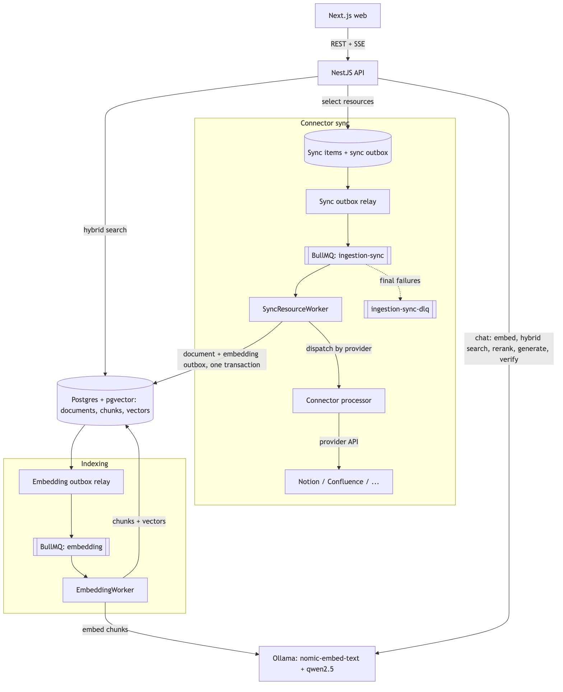

# Knowledge Engine

An internal knowledge assistant that syncs content from your workspace tools through pluggable **connectors** (Notion today, more planned), plus direct uploads. It indexes everything locally and answers questions with **verifiable `[Source N]` citations**, or refuses when the evidence is not there. Everything runs on your own machine: local LLM and embeddings through Ollama, with no cloud AI calls.

## Problem & Value

Team knowledge is scattered across tools like Notion and Confluence that nobody can search together, and generic chatbots make up answers. Knowledge Engine:

- **Brings sources together.** Every connector feeds the same canonical document store, so one question searches them all.
- **Keeps knowledge current.** Selected resources sync in the background, and unchanged ones are skipped.
- **Answers only from your documents.** Every claim must cite a retrieved source, and unsupported answers are refused.
- **Keeps data private.** Documents, vectors and the model all stay local.

## Demo

- **Video:** _add link_
- **Workflow:** connect a source (e.g. Notion) → select resources → they sync and are indexed → ask in chat → get a cited answer, or a clear refusal.

## Architecture



<sub>Diagram source: [`docs/assets/architecture.mmd`](docs/assets/architecture.mmd). Re-render with `npx -p @mermaid-js/mermaid-cli mmdc -i docs/assets/architecture.mmd -o docs/assets/architecture.png -s 2 -b white`.</sub>

- **Durable by design.** Every write saves its domain row and its outbox row in one ACID transaction. Relays drain outboxes with `FOR UPDATE SKIP LOCKED`, and deterministic job ids (`sync:<connection>:<resource>`, `embed:<doc>:<version>`) prevent duplicate jobs.
- **Change detection.** A cheap check of the provider's revision timestamp runs first (e.g. Notion `last_edited_time`), then a SHA-256 hash of the canonical Markdown. Only real changes create a new document version.
- **Safe versioning.** Versions only go up. Stale or deselected results are rejected under a row lock, and the embedding worker skips outdated versions.
- **Grounded chat.** Hybrid search (pgvector cosine + Postgres full-text) feeds a relevance gate and an optional cross-encoder reranker. The answer is then checked citation by citation.

More detail is in [`docs/`](docs/): [architecture](docs/architecture.md), [ingestion & sync](docs/ingestion-and-sync.md), [retrieval & citations](docs/retrieval-and-citations.md), [jobs & reliability](docs/jobs-and-reliability.md), [security](docs/security.md).

## Connectors

The sync pipeline doesn't depend on any one provider. A connector only supplies the provider-specific parts. Outbox, queueing, change detection, versioning, dead-lettering and indexing are shared.

| Source | Status | Type |
| --- | --- | --- |
| Notion | ✅ Implemented | OAuth connector, pages synced as resources |
| Confluence | 🗺️ Planned | Connector (provider type already reserved) |

**Adding a connector** (`apps/backend/src/modules/`):

1. **Client:** API access and auth (e.g. `ingestion/connectors/notion/notion.client.ts`). Credentials are stored per provider, encrypted with AES-256-GCM, by `connector-persistence`.
2. **Parser:** converts provider content into the canonical Markdown AST (`ingestion/normalizers/<provider>/`). `CanonicalDocumentNormalizer` then produces the content hash.
3. **Sync processor:** implements `KnowledgeSyncProcessor.syncResource()` (`ingestion/interfaces/knowledge-sync-processor.interface.ts`) and returns `NO_OP`, `UPDATED` or `FAILED`.
4. **Register it:** add it to the `KNOWLEDGE_SYNC_PROCESSORS` provider in `ingestion/ingestion.module.ts`, and add its name to `SYNC_PROVIDERS` (`queue/queue.constants.ts`).
5. **Integration routes:** OAuth/connect, resource listing and selection (see `integrations/integrations.controller.ts` for Notion).

## Technology

| Layer | Choice |
| --- | --- |
| Backend | NestJS 12, TypeScript, TypeORM |
| Data | PostgreSQL 16 + `pgvector` (HNSW cosine index, `tsvector` full-text) |
| Jobs | Redis 7 + BullMQ, transactional outbox, dead-letter queue |
| AI | Ollama: `nomic-embed-text` (768-dim embeddings), `qwen2.5:7b-instruct` (generation); optional TEI cross-encoder reranker |
| Frontend | Next.js (App Router), shadcn/ui, Tailwind |
| Ops | Docker Compose, OpenTelemetry → Jaeger, structured JSON logs |
| Repo | pnpm + Turborepo monorepo |

## Getting Started

**Prerequisites:** Node ≥ 24, pnpm, Docker.

```bash
pnpm install
cp apps/backend/.env.example apps/backend/.env.development   # set PORT=5003 (macOS AirPlay uses 5000)

# Postgres, Redis, Jaeger, Ollama + model pull (~5 GB the first time)
cd apps/backend
docker compose --env-file .env.development -f docker-compose.dev.yaml up -d postgres redis jaeger ollama ollama-init
cd ../..

pnpm dev    # web → http://localhost:3000, API → http://localhost:5003 (Swagger at /api/docs)
```

- Migrations run automatically when the API starts.
- Set `NEXT_PUBLIC_BACKEND_URL=http://localhost:5003` in `apps/web/.env.development`.
- Connector setup: Notion OAuth is described in [docs/notion-oauth-setup.md](docs/notion-oauth-setup.md).
- Tests: `pnpm --filter @my-project/backend test`. Type checks: `pnpm check-types`.

## Built with AI

AI is part of the core data path, not just a chat front end:

1. An embedding model turns every document chunk into a vector that drives retrieval.
2. The LLM rewrites follow-up questions into standalone search queries.
3. A reranker model reorders retrieved evidence.
4. The LLM's answer is parsed and checked programmatically before it is shown.

## AI Usage Disclosure

The team leveraged AI-assisted development throughout the project's development.

## Limitations

- **No end-user authentication or authorization.** Chat and document endpoints are open. Only the integration endpoints check a single shared admin key (`AdminAuthGuard`). There are no users, roles or per-document permissions, and source permissions (e.g. who can see a Notion page) are not enforced at answer time.
- **No sensitive-data masking.** Synced content, prompts and answers are stored and logged as-is. The PII/secret redaction in `common/logger/structured-logger.ts` is commented out, and nothing is masked before indexing or generation.
- **One connector so far, single tenant.** Notion is the only connector implemented. Confluence is planned but not built, and each connector still has its own integration routes (`/v1/integrations/notion/*`). Sync starts when resources are selected; there are no webhooks or periodic re-sync.
- **Local-model quality and speed.** A 7B model on CPU (Docker on macOS) is slow and can miss nuance. Answers are only as good as the retrieved chunks.
- **Operational gaps.** There is no tool to inspect or replay the dead-letter queue, no metrics dashboard, and no production deployment of the AI services (`docker-compose.prod.yaml` covers only API and web).

## Future Improvements

- SSO / OIDC login with role and source-permission-aware retrieval.
- PII and secret detection with masking before indexing, plus redacted logs.
- More connectors (Confluence, Google Drive, GitHub wikis), generic `/v1/integrations/:provider` routes, webhooks and scheduled re-sync.
- Admin UI for sync status, DLQ inspection and replay.
- Answer-quality evals in CI (`test/eval/`) and GPU or hosted inference options.

## Repository Layout

```
apps/backend   NestJS API, workers, migrations (src/modules: ingestion + connectors, indexing, conversation, connector-persistence, documents, queue)
apps/web       Next.js UI (chat, documents, integrations)
apps/app       Expo mobile client (early stage)
packages/      shared api-client, ui, eslint and typescript configs
docs/          architecture and design notes
openspec/      specs and change proposals that drove the AI-assisted implementation
```
