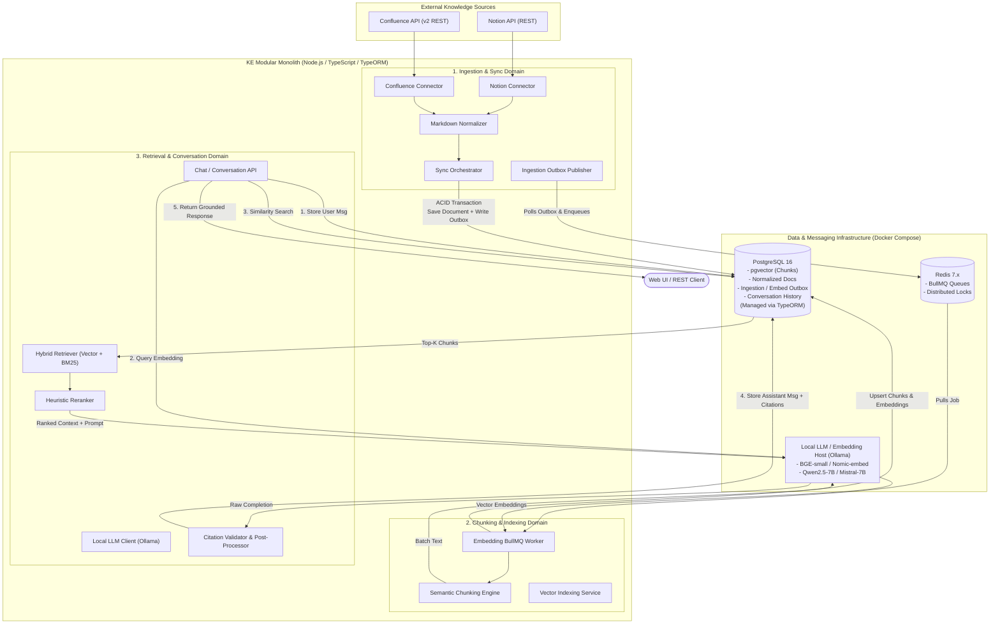

# System Architecture

The **Knowledge Engine (KE)** is structured as a **TypeScript Modular Monolith**. It guarantees clean module boundaries, high developer velocity, and single-container operational simplicity during local Docker Compose deployment.

---

## 🏗️ High-Level System Architecture



---

## 🔄 End-to-End Data Lifecycle

The system coordinates two asynchronous background pipelines and one synchronous query pipeline:

```
[Connectors] ─(Poll/Sync)─> [Document Store + Outbox] ─(BullMQ)─> [Chunk & Embed] ─(pgvector)─> [Search & RAG]
```

### 1. Ingestion & Synchronization Pipeline (Asynchronous)
1. **Trigger**: Cron schedule or manual API trigger emits an `ingestion_job`.
2. **Connector Execution**: Connector authenticates via token/Basic auth, queries source API with pagination and incremental timestamp cursors (`last_modified_at > cursor`).
3. **Normalization**: HTML/Block payloads are stripped of proprietary markup and transformed into clean GFM Markdown with frontmatter.
4. **Hashing & Change Detection**: A SHA-256 hash of the normalized content is compared with the stored `content_hash` in PostgreSQL:
   - **Unchanged**: Job updates `last_synced_at`, skips downstream processing.
   - **Modified/New**: Document record is upserted, status set to `pending_embedding`, and an entry is written to `embedding_outbox` inside the same TypeORM database transaction.
   - **Deleted in Source**: Soft-deleted/tombstoned in PostgreSQL (`deleted_at = NOW()`), and associated chunks are purged.
5. **Outbox Relay**: A lightweight transactional publisher reads pending outbox entries and publishes job payloads to Redis BullMQ.

### 2. Chunking, Embedding & Indexing Pipeline (Worker-Driven)
1. **BullMQ Dispatch**: Embedding worker picks up the job from `embedding-queue`.
2. **Atomic Version Check**: Worker verifies document version to avoid stale worker overwrites (protects against race conditions).
3. **Chunking**: Document is sliced using recursive character splitting with Markdown boundary awareness (headers, code blocks, lists preserved).
4. **Local Embedding Generation**: Batched chunks are sent to the local embedding server (`nomic-embed-text` or `bge-small-en-v1.5`, 384/768-d).
5. **Atomic Vector Upsert**: Within a single TypeORM transaction (`queryRunner.manager.transaction`):
   - Existing active chunks for `document_id` are deleted.
   - New chunks and vector embeddings are bulk-inserted.
   - Document state transitions to `indexed`.

### 3. Stateful RAG & Query Pipeline (Synchronous with Streaming Support)
1. **User Request**: Client sends a question optionally carrying a `conversation_id`.
2. **Session & Ownership Setup**:
   - If no `conversation_id`, create a new `conversation` record.
   - Validate authorization/ownership.
3. **Message Persistence (User)**: User message is committed to `conversation_message` with `status = 'completed'`.
4. **Context & History Loading**: Retrieve the last $N$ messages (bounded sliding context window) from PostgreSQL via TypeORM.
5. **Hybrid Retrieval**:
   - Embed user query using local embedding endpoint.
   - Execute cosine distance vector search (`<=>`) over `chunk.embedding` filtered by `document.deleted_at IS NULL`.
   - Perform keyword matching (`tsvector @@ tsquery`) for exact code symbols, IDs, or acronyms.
   - Merge and deduplicate top $K$ chunks.
6. **Prompt Assembly & Grounding**: Build system prompt injecting retrieved chunks with strictly formatted citation tags `[Source N: Doc Title (URL)]`.
7. **Local LLM Inference**: Submit to local LLM (`qwen2.5:7b-instruct` or `mistral-7b-instruct-v0.3`) with temperature $\le 0.1$.
8. **Citation Verification & Fallback**:
   - Parser checks if generated citations map directly to retrieved chunks.
   - If evidence is insufficient, return standardized fallback response: *"I cannot find sufficient evidence in the indexed documentation to answer this question."*
9. **Message Persistence (Assistant)**: Assistant message, citations JSON, and response metadata are committed to `conversation_message`.
10. **Client Delivery**: Response payload is returned to the client.

---

## 🧩 Modular Monolith Boundaries & Code Organization

The codebase is organized into decoupled domain modules under `src/modules/` sharing a common data access layer:

| Module | Directory | Public Interface / Boundary Export |
| :--- | :--- | :--- |
| **Ingestion** | `src/modules/ingestion/` | `IngestionService.triggerSync()`, `IngestionService.getStatus()` |
| **Indexing** | `src/modules/indexing/` | `IndexingService.enqueueDocument()`, `VectorStoreService` |
| **Conversation & RAG** | `src/modules/conversation/` | `ConversationService.handleUserMessage()`, `ChatController` |
| **Shared Core** | `src/shared/` | TypeORM `AppDataSource`, Entities, Redis client, Logger, Shared DTOs |

### Inter-Module Communication Rules
1. **No direct cross-module database writes**: The Ingestion module never writes directly to chunk tables.
2. **Asynchronous decoupling via Outbox**: Ingestion signals Indexing via `embedding_outbox` and BullMQ queue payloads.
3. **Synchronous read contracts**: The Conversation module queries chunks via `VectorStoreService` interface rather than raw ad-hoc database queries scattered across modules.

---

## 🏛️ Key Architectural Decisions Summary

1. **Modular Monolith over Microservices**:
   - Packaged into a single deployable container.
   - Eliminates network serialization latency, distributed transaction overhead, and multi-service deployment friction.
2. **PostgreSQL 16 + pgvector over Dedicated Vector Database**:
   - Consolidates relational state, full-text search, and vector embeddings in a single ACID-compliant database.
   - Ensures vectors are updated or purged in the same transaction as document updates.
3. **Transactional Outbox + BullMQ over Direct Publishing**:
   - Outbox rows written in the same transaction as document state updates.
   - Background poller relay guarantees at-least-once delivery to BullMQ even during network or Redis restarts.
4. **Local OSS Model Serving (Ollama) over Cloud APIs**:
   - 100% offline, zero data exfiltration, local privacy preservation.
5. **Monotonic Versioning & Atomic Chunk Swapping**:
   - Prevents race conditions where an earlier embedding job finishes after a newer version.

See [[data-model]] for entity schemas and [[jobs-and-reliability]] for worker mechanics.
