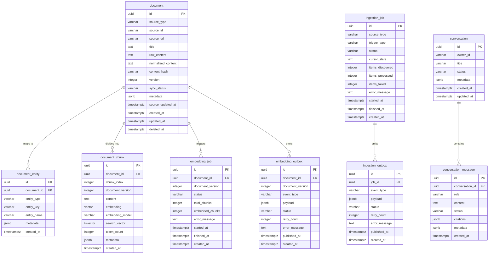

# Data Model & Storage Specifications

This document defines the relational schema, vector storage specifications, constraints, and TypeORM entity definitions for the Knowledge Engine in PostgreSQL 16.

---

## 📊 Entity Relationship Diagram



---

## 🗄️ PostgreSQL DDL

```sql
-- Extensions
CREATE EXTENSION IF NOT EXISTS "uuid-ossp";
CREATE EXTENSION IF NOT EXISTS "vector";
CREATE EXTENSION IF NOT EXISTS "pg_trgm";

-- 1. Document & Entity Tables
CREATE TABLE document (
    id UUID PRIMARY KEY DEFAULT uuid_generate_v4(),
    source_type VARCHAR(32) NOT NULL,
    source_id VARCHAR(255) NOT NULL,
    source_url TEXT NOT NULL,
    title TEXT NOT NULL,
    raw_content TEXT,
    normalized_content TEXT NOT NULL,
    content_hash VARCHAR(64) NOT NULL,
    version INTEGER NOT NULL DEFAULT 1,
    sync_status VARCHAR(32) NOT NULL DEFAULT 'pending_embedding',
    metadata JSONB NOT NULL DEFAULT '{}'::jsonb,
    source_updated_at TIMESTAMPTZ NOT NULL,
    created_at TIMESTAMPTZ NOT NULL DEFAULT NOW(),
    updated_at TIMESTAMPTZ NOT NULL DEFAULT NOW(),
    deleted_at TIMESTAMPTZ,
    
    CONSTRAINT uq_document_source UNIQUE (source_type, source_id)
);

CREATE INDEX idx_document_lookup ON document (source_type, source_id) WHERE deleted_at IS NULL;
CREATE INDEX idx_document_sync_status ON document (sync_status);
CREATE INDEX idx_document_hash ON document (content_hash);

CREATE TABLE document_entity (
    id UUID PRIMARY KEY DEFAULT uuid_generate_v4(),
    document_id UUID NOT NULL REFERENCES document(id) ON DELETE CASCADE,
    entity_type VARCHAR(64) NOT NULL,
    entity_key VARCHAR(128) NOT NULL,
    entity_name VARCHAR(255) NOT NULL,
    metadata JSONB NOT NULL DEFAULT '{}'::jsonb,
    created_at TIMESTAMPTZ NOT NULL DEFAULT NOW(),

    CONSTRAINT uq_document_entity UNIQUE (document_id, entity_type, entity_key)
);

CREATE INDEX idx_doc_entity_lookup ON document_entity (entity_type, entity_key);

-- 2. Chunks & pgvector Indexing
CREATE TABLE document_chunk (
    id UUID PRIMARY KEY DEFAULT uuid_generate_v4(),
    document_id UUID NOT NULL REFERENCES document(id) ON DELETE CASCADE,
    chunk_index INTEGER NOT NULL,
    document_version INTEGER NOT NULL,
    content TEXT NOT NULL,
    -- Width must equal the embedding model output (nomic-embed-text = 768); the app refuses to boot otherwise
    embedding VECTOR(768) NOT NULL,
    -- Model that produced the vector; retrieval only compares vectors from the active model
    embedding_model VARCHAR(128) NOT NULL,
    -- Maintained by PostgreSQL for the keyword half of hybrid retrieval
    search_vector TSVECTOR GENERATED ALWAYS AS (to_tsvector('english', content)) STORED,
    token_count INTEGER NOT NULL,
    metadata JSONB NOT NULL DEFAULT '{}'::jsonb,
    created_at TIMESTAMPTZ NOT NULL DEFAULT NOW(),

    CONSTRAINT uq_document_chunk_version UNIQUE (document_id, document_version, chunk_index)
);

CREATE INDEX idx_chunk_embedding_hnsw 
ON document_chunk 
USING hnsw (embedding vector_cosine_ops)
WITH (m = 16, ef_construction = 64);

CREATE INDEX idx_chunk_search_vector ON document_chunk USING gin (search_vector);
CREATE INDEX idx_chunk_doc_ver ON document_chunk (document_id, document_version);

-- 3. Jobs & Outbox Tables
CREATE TABLE ingestion_job (
    id UUID PRIMARY KEY DEFAULT uuid_generate_v4(),
    source_type VARCHAR(32) NOT NULL,
    trigger_type VARCHAR(32) NOT NULL DEFAULT 'manual',
    status VARCHAR(32) NOT NULL DEFAULT 'pending',
    cursor_state TEXT,
    items_discovered INTEGER NOT NULL DEFAULT 0,
    items_processed INTEGER NOT NULL DEFAULT 0,
    items_failed INTEGER NOT NULL DEFAULT 0,
    error_message TEXT,
    started_at TIMESTAMPTZ,
    finished_at TIMESTAMPTZ,
    created_at TIMESTAMPTZ NOT NULL DEFAULT NOW()
);

CREATE TABLE ingestion_outbox (
    id UUID PRIMARY KEY DEFAULT uuid_generate_v4(),
    job_id UUID REFERENCES ingestion_job(id) ON DELETE SET NULL,
    event_type VARCHAR(64) NOT NULL,
    payload JSONB NOT NULL,
    status VARCHAR(32) NOT NULL DEFAULT 'pending',
    retry_count INTEGER NOT NULL DEFAULT 0,
    error_message TEXT,
    published_at TIMESTAMPTZ,
    created_at TIMESTAMPTZ NOT NULL DEFAULT NOW()
);

CREATE INDEX idx_ingestion_outbox_pending ON ingestion_outbox (status, created_at) WHERE status = 'pending';

CREATE TABLE embedding_job (
    id UUID PRIMARY KEY DEFAULT uuid_generate_v4(),
    document_id UUID NOT NULL REFERENCES document(id) ON DELETE CASCADE,
    document_version INTEGER NOT NULL,
    status VARCHAR(32) NOT NULL DEFAULT 'pending',
    total_chunks INTEGER NOT NULL DEFAULT 0,
    embedded_chunks INTEGER NOT NULL DEFAULT 0,
    error_message TEXT,
    started_at TIMESTAMPTZ,
    finished_at TIMESTAMPTZ,
    created_at TIMESTAMPTZ NOT NULL DEFAULT NOW()
);

CREATE TABLE embedding_outbox (
    id UUID PRIMARY KEY DEFAULT uuid_generate_v4(),
    document_id UUID NOT NULL REFERENCES document(id) ON DELETE CASCADE,
    document_version INTEGER NOT NULL,
    event_type VARCHAR(64) NOT NULL,
    payload JSONB NOT NULL,
    status VARCHAR(32) NOT NULL DEFAULT 'pending',
    retry_count INTEGER NOT NULL DEFAULT 0,
    error_message TEXT,
    published_at TIMESTAMPTZ,
    created_at TIMESTAMPTZ NOT NULL DEFAULT NOW()
);

CREATE INDEX idx_embedding_outbox_pending ON embedding_outbox (status, created_at) WHERE status = 'pending';

-- 4. Conversation History
CREATE TABLE conversation (
    id UUID PRIMARY KEY DEFAULT uuid_generate_v4(),
    owner_id VARCHAR(128) NOT NULL DEFAULT 'local_user',
    title VARCHAR(255) NOT NULL DEFAULT 'New Conversation',
    status VARCHAR(32) NOT NULL DEFAULT 'active',
    metadata JSONB NOT NULL DEFAULT '{}'::jsonb,
    created_at TIMESTAMPTZ NOT NULL DEFAULT NOW(),
    updated_at TIMESTAMPTZ NOT NULL DEFAULT NOW()
);

CREATE INDEX idx_conversation_owner ON conversation (owner_id, updated_at DESC);

CREATE TABLE conversation_message (
    id UUID PRIMARY KEY DEFAULT uuid_generate_v4(),
    conversation_id UUID NOT NULL REFERENCES conversation(id) ON DELETE CASCADE,
    role VARCHAR(16) NOT NULL,
    content TEXT NOT NULL,
    status VARCHAR(32) NOT NULL DEFAULT 'completed',
    citations JSONB NOT NULL DEFAULT '[]'::jsonb,
    metadata JSONB NOT NULL DEFAULT '{}'::jsonb,
    created_at TIMESTAMPTZ NOT NULL DEFAULT NOW()
);

CREATE INDEX idx_conv_messages ON conversation_message (conversation_id, created_at ASC);
```

---

## 🏛️ TypeORM Entity Definitions (`src/shared/entities/`)

### 1. `Document.entity.ts`
```typescript
import {
  Entity,
  PrimaryGeneratedColumn,
  Column,
  CreateDateColumn,
  UpdateDateColumn,
  DeleteDateColumn,
  Unique,
  Index,
  OneToMany
} from 'typeorm';
import { DocumentChunk } from './DocumentChunk.entity';
import { DocumentEntity } from './DocumentEntity.entity';

export type SyncStatus = 'pending_embedding' | 'indexing' | 'indexed' | 'failed' | 'tombstoned';

@Entity('document')
@Unique('uq_document_source', ['sourceType', 'sourceId'])
export class Document {
  @PrimaryGeneratedColumn('uuid')
  id!: string;

  @Column({ name: 'source_type', type: 'varchar', length: 32 })
  sourceType!: 'notion' | 'confluence';

  @Column({ name: 'source_id', type: 'varchar', length: 255 })
  sourceId!: string;

  @Column({ name: 'source_url', type: 'text' })
  sourceUrl!: string;

  @Column({ type: 'text' })
  title!: string;

  @Column({ name: 'raw_content', type: 'text', nullable: true })
  rawContent?: string;

  @Column({ name: 'normalized_content', type: 'text' })
  normalizedContent!: string;

  @Column({ name: 'content_hash', type: 'varchar', length: 64 })
  @Index('idx_document_hash')
  contentHash!: string;

  @Column({ type: 'int', default: 1 })
  version!: number;

  @Column({ name: 'sync_status', type: 'varchar', length: 32, default: 'pending_embedding' })
  @Index('idx_document_sync_status')
  syncStatus!: SyncStatus;

  @Column({ type: 'jsonb', default: {} })
  metadata!: Record<string, any>;

  @Column({ name: 'source_updated_at', type: 'timestamptz' })
  sourceUpdatedAt!: Date;

  @CreateDateColumn({ name: 'created_at', type: 'timestamptz' })
  createdAt!: Date;

  @UpdateDateColumn({ name: 'updated_at', type: 'timestamptz' })
  updatedAt!: Date;

  @DeleteDateColumn({ name: 'deleted_at', type: 'timestamptz', nullable: true })
  deletedAt?: Date;

  @OneToMany(() => DocumentChunk, chunk => chunk.document, { cascade: true })
  chunks!: DocumentChunk[];

  @OneToMany(() => DocumentEntity, entity => entity.document, { cascade: true })
  entities!: DocumentEntity[];
}
```

### 2. `DocumentChunk.entity.ts`
```typescript
import {
  Entity,
  PrimaryGeneratedColumn,
  Column,
  CreateDateColumn,
  ManyToOne,
  JoinColumn,
  Unique,
  Index
} from 'typeorm';
import { Document } from './Document.entity';

@Entity('document_chunk')
@Unique('uq_document_chunk_version', ['documentId', 'documentVersion', 'chunkIndex'])
export class DocumentChunk {
  @PrimaryGeneratedColumn('uuid')
  id!: string;

  @Column({ name: 'document_id', type: 'uuid' })
  documentId!: string;

  @ManyToOne(() => Document, document => document.chunks, { onDelete: 'CASCADE' })
  @JoinColumn({ name: 'document_id' })
  document!: Document;

  @Column({ name: 'chunk_index', type: 'int' })
  chunkIndex!: number;

  @Column({ name: 'document_version', type: 'int' })
  documentVersion!: number;

  @Column({ type: 'text' })
  content!: string;

  // TypeORM serializes number[] to pgvector; HNSW index is created by migration (synchronize: false)
  @Column({ type: 'vector', length: EMBEDDING_VECTOR_DIMENSION })
  embedding!: number[];

  @Column({ name: 'embedding_model', type: 'varchar', length: 128 })
  embeddingModel!: string;

  @Index('idx_chunk_search_vector', { type: 'gin' })
  @Column({
    name: 'search_vector',
    type: 'tsvector',
    generatedType: 'STORED',
    asExpression: `to_tsvector('english', "content")`,
    select: false,
    insert: false,
    update: false,
  })
  searchVector?: string;

  @Column({ name: 'token_count', type: 'int' })
  tokenCount!: number;

  @Column({ type: 'jsonb', default: {} })
  metadata!: Record<string, any>;

  @CreateDateColumn({ name: 'created_at', type: 'timestamptz' })
  createdAt!: Date;
}
```

### 3. `EmbeddingOutbox.entity.ts`
```typescript
import {
  Entity,
  PrimaryGeneratedColumn,
  Column,
  CreateDateColumn,
  Index
} from 'typeorm';

export type OutboxStatus = 'pending' | 'published' | 'failed';

@Entity('embedding_outbox')
export class EmbeddingOutbox {
  @PrimaryGeneratedColumn('uuid')
  id!: string;

  @Column({ name: 'document_id', type: 'uuid' })
  documentId!: string;

  @Column({ name: 'document_version', type: 'int' })
  documentVersion!: number;

  @Column({ name: 'event_type', type: 'varchar', length: 64 })
  eventType!: string;

  @Column({ type: 'jsonb' })
  payload!: Record<string, any>;

  @Column({ type: 'varchar', length: 32, default: 'pending' })
  @Index('idx_embedding_outbox_pending')
  status!: OutboxStatus;

  @Column({ name: 'retry_count', type: 'int', default: 0 })
  retryCount!: number;

  @Column({ name: 'error_message', type: 'text', nullable: true })
  errorMessage?: string;

  @Column({ name: 'published_at', type: 'timestamptz', nullable: true })
  publishedAt?: Date;

  @CreateDateColumn({ name: 'created_at', type: 'timestamptz' })
  createdAt!: Date;
}
```

### 4. `Conversation.entity.ts` & `ConversationMessage.entity.ts`
```typescript
import {
  Entity,
  PrimaryGeneratedColumn,
  Column,
  CreateDateColumn,
  UpdateDateColumn,
  OneToMany,
  ManyToOne,
  JoinColumn,
  Index
} from 'typeorm';

@Entity('conversation')
export class Conversation {
  @PrimaryGeneratedColumn('uuid')
  id!: string;

  @Column({ name: 'owner_id', type: 'varchar', length: 128, default: 'local_user' })
  @Index('idx_conversation_owner')
  ownerId!: string;

  @Column({ type: 'varchar', length: 255, default: 'New Conversation' })
  title!: string;

  @Column({ type: 'varchar', length: 32, default: 'active' })
  status!: string;

  @Column({ type: 'jsonb', default: {} })
  metadata!: Record<string, any>;

  @CreateDateColumn({ name: 'created_at', type: 'timestamptz' })
  createdAt!: Date;

  @UpdateDateColumn({ name: 'updated_at', type: 'timestamptz' })
  updatedAt!: Date;

  @OneToMany(() => ConversationMessage, msg => msg.conversation, { cascade: true })
  messages!: ConversationMessage[];
}

@Entity('conversation_message')
export class ConversationMessage {
  @PrimaryGeneratedColumn('uuid')
  id!: string;

  @Column({ name: 'conversation_id', type: 'uuid' })
  conversationId!: string;

  @ManyToOne(() => Conversation, conv => conv.messages, { onDelete: 'CASCADE' })
  @JoinColumn({ name: 'conversation_id' })
  conversation!: Conversation;

  @Column({ type: 'varchar', length: 16 })
  role!: 'user' | 'assistant' | 'system';

  @Column({ type: 'text' })
  content!: string;

  @Column({ type: 'varchar', length: 32, default: 'completed' })
  status!: 'pending' | 'generating' | 'completed' | 'failed';

  @Column({ type: 'jsonb', default: [] })
  citations!: Array<{
    sourceIndex: number;
    documentId: string;
    title: string;
    sourceUrl: string;
    snippet: string;
  }>;

  @Column({ type: 'jsonb', default: {} })
  metadata!: Record<string, any>;

  @CreateDateColumn({ name: 'created_at', type: 'timestamptz' })
  @Index('idx_conv_messages')
  createdAt!: Date;
}
```

---

## 🧱 Schema Management (Migrations)

The schema is owned by TypeORM migrations in `apps/backend/src/database/migrations/`; the app runs pending migrations on startup (`migrationsRun: true`). `DATABASE_SYNCHRONIZE` defaults to `false` and should stay off outside throwaway databases.

| Command (in `apps/backend`) | Purpose |
| :--- | :--- |
| `pnpm migration:generate src/database/migrations/<Name>` | Diff entities against the database and write a migration; register it in `migrations/index.ts` |
| `pnpm migration:run` / `pnpm migration:revert` | Apply or roll back the latest migration |
| `pnpm migration:show` | List applied and pending migrations |

Rules:
- Anything TypeORM cannot express (the HNSW index, extensions) is added to the migration by hand and marked `synchronize: false` on the entity so schema sync never drops it.
- **Embeddings**: questions and passages are embedded with `IEmbeddingProvider.embed(texts, 'query' | 'document')`, which applies the model's task prefix (e.g. `search_query:` / `search_document:` for nomic). Changing the embedding model or its width requires a migration plus a full re-embed; retrieval filters on `embedding_model` so vectors from different models are never compared.

---

## 🎯 Semantics of Key Entities

### `document` Semantics & Versioning
- **Canonical Store**: `document` is the sole source of truth for normalized content.
- **Content Hash**: `SHA-256(normalized_content)`. If a connector sync fetches a document whose hash matches PostgreSQL, no version increment or re-embedding occurs.
- **Monotonic Version**: Every content modification increments `version = version + 1`. This prevents out-of-order background embedding jobs from overwriting newer content.
- **Tombstoning**: Documents deleted in Notion/Confluence are marked with `deleted_at = NOW()`, `sync_status = 'tombstoned'`. Their chunks are immediately purged.

### `document_entity` Semantics
- Represents M:N domain metadata linking documents to business entities (e.g. spaces, projects, teams).
- Extracted during normalization (e.g. `entity_type = 'space'`, `entity_key = 'ENGINEERING'`).
- Enables ticket-aware context filtering without schema changes.

See [[jobs-and-reliability]] for outbox publishing logic and worker lifecycle.

---

## 🔌 Connector Persistence Data Model

The `ConnectorPersistenceModule` provides durable, multi-provider connection storage, authenticated credential encryption, and single-use OAuth state tokens.

### 1. `ConnectorConnectionEntity` (`connector_connection`)
Tracks durable connection metadata, lifecycle status, and workspace details.

```typescript
@Entity('connector_connection')
@Index('idx_uq_active_connector', ['provider'], {
  unique: true,
  where: "status IN ('CONNECTED', 'REAUTH_REQUIRED')",
})
export class ConnectorConnectionEntity {
  @PrimaryGeneratedColumn('uuid')
  id!: string;

  @Column({ type: 'varchar', length: 64 })
  @Index('idx_connector_provider')
  provider!: string; // 'notion', 'confluence', etc.

  @Column({
    type: 'varchar',
    length: 32,
    default: ConnectorConnectionStatus.CONNECTED,
  })
  status!: ConnectorConnectionStatus; // 'CONNECTED' | 'REAUTH_REQUIRED' | 'DISCONNECTED'

  @Column({ name: 'external_account_id', type: 'varchar', length: 255 })
  externalAccountId!: string; // e.g. Notion workspace_id

  @Column({ name: 'external_account_name', type: 'varchar', length: 255, nullable: true })
  externalAccountName?: string;

  @Column({ name: 'connected_by_user_id', type: 'varchar', length: 128, default: 'admin-user' })
  connectedByUserId!: string;

  @Column({
    name: 'auth_type',
    type: 'varchar',
    length: 32,
    default: ConnectorAuthType.OAUTH2,
  })
  authType!: ConnectorAuthType;

  @Column({ name: 'connected_at', type: 'timestamptz' })
  connectedAt!: Date;

  @Column({ name: 'last_verified_at', type: 'timestamptz', nullable: true })
  lastVerifiedAt?: Date;

  @Column({ name: 'disconnected_at', type: 'timestamptz', nullable: true })
  disconnectedAt?: Date;

  @Column({ type: 'jsonb', nullable: true })
  metadata?: Record<string, any>; // e.g. { selectedPageIds: string[], workspaceIcon: string }

  @OneToOne(() => ConnectorCredentialEntity, (cred) => cred.connection, {
    cascade: ['insert', 'update', 'remove'],
  })
  credential?: ConnectorCredentialEntity;
}
```

### 2. `ConnectorCredentialEntity` (`connector_credential`)
Stores encrypted authentication secrets in 1-to-1 relationship with the connection record.

```typescript
@Entity('connector_credential')
export class ConnectorCredentialEntity {
  @PrimaryGeneratedColumn('uuid')
  id!: string;

  @Column({ name: 'connection_id', type: 'uuid' })
  @Index('idx_uq_connector_credential_conn', { unique: true })
  connectionId!: string;

  @OneToOne(() => ConnectorConnectionEntity, (conn) => conn.credential, {
    onDelete: 'CASCADE',
  })
  @JoinColumn({ name: 'connection_id' })
  connection!: ConnectorConnectionEntity;

  @Column({ name: 'encrypted_payload', type: 'text' })
  encryptedPayload!: string; // AES-256-GCM format: iv.tag.ciphertext (hex)

  @Column({ name: 'encryption_key_version', type: 'int', default: 1 })
  encryptionKeyVersion!: number;

  @Column({ name: 'expires_at', type: 'timestamptz', nullable: true })
  expiresAt?: Date;

  @CreateDateColumn({ name: 'created_at', type: 'timestamptz' })
  createdAt!: Date;

  @UpdateDateColumn({ name: 'updated_at', type: 'timestamptz' })
  updatedAt!: Date;
}
```

### 3. `OAuthStateEntity` (`oauth_state`)
Provides durable anti-CSRF OAuth verification across application restarts with atomic single-use consumption.

```typescript
@Entity('oauth_state')
export class OAuthStateEntity {
  @PrimaryColumn({ type: 'varchar', length: 64 })
  state!: string; // 32-byte cryptographic hex token

  @Column({ type: 'varchar', length: 64 })
  provider!: string;

  @Column({ name: 'user_id', type: 'varchar', length: 128, default: 'admin-user' })
  userId!: string;

  @Column({ name: 'expires_at', type: 'timestamptz' })
  @Index('idx_oauth_state_expires')
  expiresAt!: Date;

  @Column({ name: 'consumed_at', type: 'timestamptz', nullable: true })
  consumedAt?: Date;

  @CreateDateColumn({ name: 'created_at', type: 'timestamptz' })
  createdAt!: Date;
}
```

### 🔄 Multi-Connector Concurrency & State Invariants
- **Multi-Connector Support**: Multiple different providers (`notion`, `confluence`, `jira`) can be connected concurrently.
- **Single Active Connection per Provider**: The partial index `idx_uq_active_connector` guarantees that at most one active connection (`CONNECTED` or `REAUTH_REQUIRED`) exists per provider at any time.
- **Lifecycle States**:
  - `CONNECTED`: Valid credentials, verified communication.
  - `REAUTH_REQUIRED`: Provider explicitly returned HTTP 401 Unauthorized or revoked token. Metadata is preserved for seamless reconnection.
  - `DISCONNECTED`: User or admin explicitly severed the connection; credentials purged.

