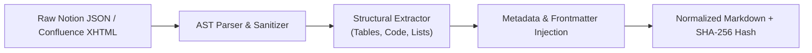
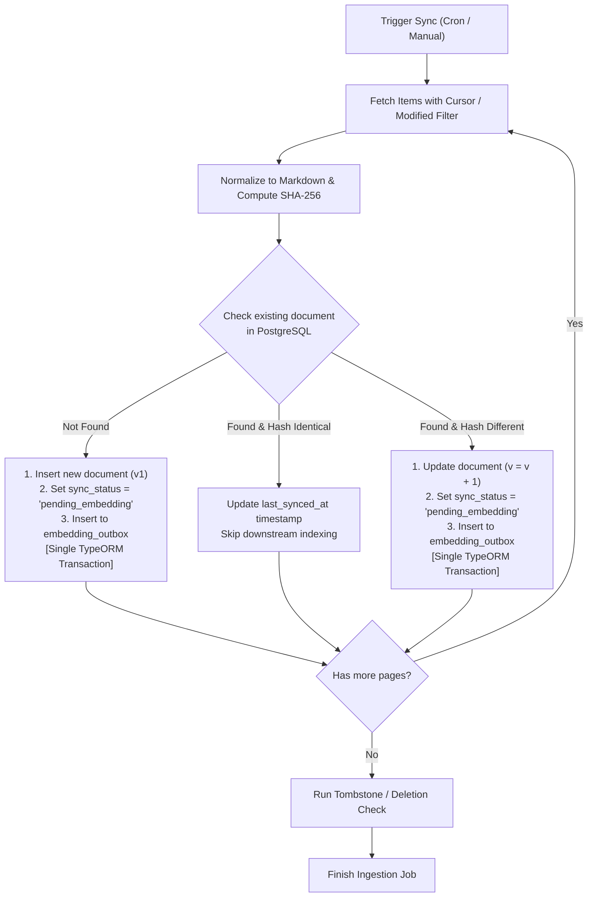

# Ingestion & Synchronization Engine

This document details the connector architecture, incremental synchronization, content normalization, deletion handling, and outbox emission for the Knowledge Engine.

---

## 🔌 Connector Architecture & Contracts

Both Notion and Confluence connectors adhere to a unified TypeScript interface `KnowledgeConnector` to maintain strict modular decoupling.

```typescript
export interface ConnectorConfig {
  sourceType: 'notion' | 'confluence';
  baseUrl?: string;
  auth: {
    token?: string;            // Notion Bearer token or Confluence API token
    username?: string;         // Confluence email/username
  };
  syncFilter?: {
    spaceKeys?: string[];      // Confluence spaces to include
    parentPageIds?: string[];  // Notion root pages to include
    since?: Date;              // Incremental timestamp filter
  };
}

export interface RawSourceItem {
  sourceId: string;
  sourceType: 'notion' | 'confluence';
  title: string;
  sourceUrl: string;
  rawPayload: any;
  sourceUpdatedAt: Date;
  metadata: Record<string, any>;
}

export interface NormalizedDocumentPayload {
  sourceType: 'notion' | 'confluence';
  sourceId: string;
  sourceUrl: string;
  title: string;
  rawContent: string;
  normalizedContent: string;
  contentHash: string;
  sourceUpdatedAt: Date;
  metadata: {
    spaceKey?: string;
    parentHierarchy: string[];
    author?: string;
    tags?: string[];
    [key: string]: any;
  };
}

export interface KnowledgeConnector {
  testConnection(): Promise<{ success: boolean; message: string }>;
  fetchIncremental(cursor?: string): Promise<{
    items: RawSourceItem[];
    nextCursor?: string;
    hasMore: boolean;
  }>;
  fetchDeletions(since: Date): Promise<string[]>; // Returns list of deleted sourceIds
}
```

---

## 🔄 Connector Implementations

### 1. Notion Connector (`src/modules/ingestion/connectors/notion.connector.ts`)
- **API Surface**: Notion API `v1/search` and `v1/blocks/{id}/children`.
- **Auth**: Internal Integration Token (`Authorization: Bearer secret_...`, `Notion-Version: 2022-06-28`).
- **Pagination**: Cursor-based (`start_cursor` and `page_size = 100`).
- **Rate Limit Handling**: Notion enforces ~3 req/sec average.
  - Implement 429 backoff with jitter and respect `Retry-After` header.
- **Hierarchy Retrieval**: Recursive traversal of child blocks for each page.

### 2. Confluence Connector (`src/modules/ingestion/connectors/confluence.connector.ts`)
- **API Surface**: Confluence REST API v2 (`/wiki/api/v2/pages`).
- **Auth**: Basic Auth (Base64-encoded `email:api_token`).
- **Pagination**: Cursor-based using `cursor` links returned by Confluence v2 API (`limit = 50`).
- **Incremental Filtering**: Query with CQL / modified query: `body-format=storage,atlas_doc_format&sort=-modified`.
- **Rate Limit Handling**: Exponential backoff with maximum 5 retries.

---

## 🧹 Content Normalization Engine

Raw API payloads (Notion JSON block trees and Confluence XHTML/Atlassian Document Format) are normalized into standardized **GitHub Flavored Markdown (GFM)** before storage.



### Normalization Rules
1. **Headings**: Normalized to `#`, `##`, `###` without skipping levels.
2. **Tables**: Preserved as clean GFM Markdown tables (`| Col 1 | Col 2 |`). If tables contain nested markup, text content is preserved without breaking column alignment.
3. **Code Blocks**: Formatted with triple backticks and language identifiers (` ```typescript `).
4. **Links**: Preserved as standard Markdown links `[Text](URL)`.
5. **Frontmatter Header**: Injected at the top of every normalized document to give context to chunk embeddings:

```markdown
---
title: "Engineering Onboarding & Local Setup"
source: "confluence"
source_url: "https://org.atlassian.net/wiki/spaces/ENG/pages/102938"
space: "ENG"
updated_at: "2026-10-08T09:30:00Z"
hierarchy: ["Engineering", "Guides", "Onboarding"]
---

# Engineering Onboarding & Local Setup
...
```

---

## ⚡ Incremental Synchronization Algorithm



---

## 🗑️ Deletion & Tombstone Handling

When a page is deleted in Notion or Confluence, the system guarantees it is no longer retrievable:

1. **Detection**:
   - **Confluence**: Query `/wiki/api/v2/pages?status=trashed` or compare active source IDs returned during a full reconciliation run.
   - **Notion**: Inspect `archived: true` or `in_trash: true` flags in page search payloads.
2. **TypeORM Deletion Transaction**:
   ```typescript
   await dataSource.transaction(async (manager) => {
     const docRepo = manager.getRepository(Document);
     const chunkRepo = manager.getRepository(DocumentChunk);

     const doc = await docRepo.findOne({
       where: { sourceType: 'notion', sourceId }
     });

     if (doc) {
       doc.deletedAt = new Date();
       doc.syncStatus = 'tombstoned';
       await docRepo.save(doc);

       // Purge chunks to prevent stale retrieval immediately
       await chunkRepo.delete({ documentId: doc.id });
     }
   });
   ```

---

## 📦 Ingestion Outbox Publishing with TypeORM

Every new or modified document is transactionally recorded in `embedding_outbox` inside the same database transaction that saves the document:

```typescript
import { DataSource } from 'typeorm';
import { Document } from '../../shared/entities/Document.entity';
import { EmbeddingOutbox } from '../../shared/entities/EmbeddingOutbox.entity';

export async function saveNormalizedDocument(
  dataSource: DataSource,
  payload: NormalizedDocumentPayload
): Promise<Document> {
  return await dataSource.transaction(async (manager) => {
    const docRepo = manager.getRepository(Document);
    const outboxRepo = manager.getRepository(EmbeddingOutbox);

    let doc = await docRepo.findOne({
      where: { sourceType: payload.sourceType, sourceId: payload.sourceId }
    });

    if (doc) {
      if (doc.contentHash === payload.contentHash) {
        // Unchanged content; update timestamp only
        doc.sourceUpdatedAt = payload.sourceUpdatedAt;
        return await docRepo.save(doc);
      }
      doc.title = payload.title;
      doc.rawContent = payload.rawContent;
      doc.normalizedContent = payload.normalizedContent;
      doc.contentHash = payload.contentHash;
      doc.version += 1;
      doc.syncStatus = 'pending_embedding';
      doc.metadata = payload.metadata;
      doc.sourceUpdatedAt = payload.sourceUpdatedAt;
      doc.deletedAt = undefined;
    } else {
      doc = docRepo.create({
        sourceType: payload.sourceType,
        sourceId: payload.sourceId,
        sourceUrl: payload.sourceUrl,
        title: payload.title,
        rawContent: payload.rawContent,
        normalizedContent: payload.normalizedContent,
        contentHash: payload.contentHash,
        version: 1,
        syncStatus: 'pending_embedding',
        metadata: payload.metadata,
        sourceUpdatedAt: payload.sourceUpdatedAt
      });
    }

    const savedDoc = await docRepo.save(doc);

    // Transactionally enqueue outbox event
    const outboxRecord = outboxRepo.create({
      documentId: savedDoc.id,
      documentVersion: savedDoc.version,
      eventType: 'DOCUMENT_READY_FOR_EMBEDDING',
      payload: {
        documentId: savedDoc.id,
        documentVersion: savedDoc.version,
        sourceType: savedDoc.sourceType,
        title: savedDoc.title
      },
      status: 'pending'
    });

    await outboxRepo.save(outboxRecord);
    return savedDoc;
  });
}
```

See [[jobs-and-reliability]] for details on the Outbox Relay worker and BullMQ queue mechanics.
