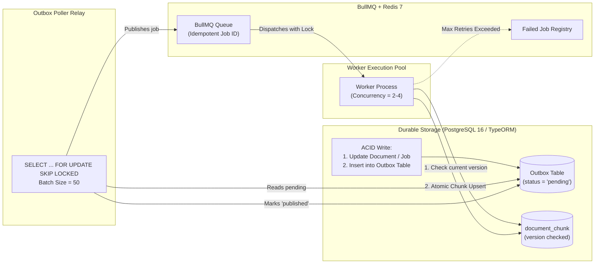
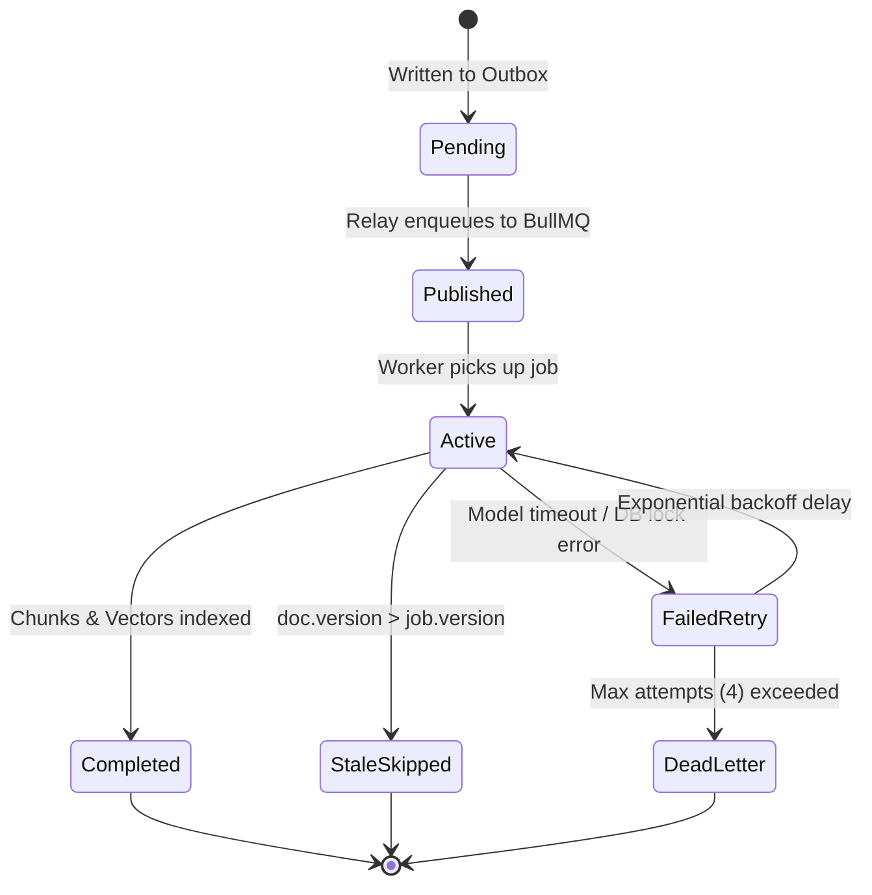

# Jobs & Reliability Engineering

This document specifies the distributed job architecture, BullMQ queues, transactional outbox pattern, idempotency guarantees, and failure recovery mechanics for the Knowledge Engine.

---

## ⚙️ Core Reliability Architecture

In distributed systems, **at-least-once delivery** is the only safe operational assumption. We eliminate duplicate processing bugs and race conditions through **database-backed transactional outboxes**, **deterministic idempotency keys**, and **version-checked database transactions**.



---

## 📬 Queue Topology & Payloads

The system defines two primary BullMQ queues in `src/shared/queues/`:

### 1. `ingestion-queue`
Processes source synchronization triggers.
```typescript
export interface IngestionJobPayload {
  jobId: string;               // UUID of the ingestion_job record
  sourceType: 'notion' | 'confluence';
  triggerType: 'scheduled' | 'manual';
  cursorState?: string;
}
```

### 2. `embedding-queue`
Processes document chunking and vector embedding generation.
```typescript
export interface EmbeddingJobPayload {
  documentId: string;          // UUID of document
  documentVersion: number;     // Monotonic version integer
  sourceType: string;
  title: string;
}
```

---

## 🔄 Transactional Outbox Pattern & Relay Service

To prevent the **dual-write problem** (where a database write succeeds but Redis publish fails, or vice versa), the application writes both the entity and the outbox event in the same ACID transaction.

### Outbox Poller Worker (`src/modules/indexing/outbox.relay.ts`)
Runs every 1000ms using row-level locking via TypeORM:

```typescript
import { DataSource } from 'typeorm';
import { Queue } from 'bullmq';
import { EmbeddingOutbox } from '../../shared/entities/EmbeddingOutbox.entity';

export async function pollAndPublishOutbox(dataSource: DataSource, embeddingQueue: Queue): Promise<number> {
  return await dataSource.transaction(async (manager) => {
    // Lock rows to prevent concurrent poller race conditions
    const pendingEvents = await manager
      .createQueryBuilder(EmbeddingOutbox, 'outbox')
      .setLock('pessimistic_write')
      .setOnLocked('skip_locked')
      .where('outbox.status = :status', { status: 'pending' })
      .orderBy('outbox.created_at', 'ASC')
      .take(50)
      .getMany();

    if (pendingEvents.length === 0) return 0;

    for (const event of pendingEvents) {
      const payload = event.payload;

      // Deterministic BullMQ Job ID ensures deduplication in Redis
      const bullMqJobId = `embed:${payload.documentId}:${payload.documentVersion}`;

      await embeddingQueue.add('embed-document', payload, {
        jobId: bullMqJobId,
        attempts: 4,
        backoff: {
          type: 'exponential',
          delay: 2000 // 2s, 4s, 8s, 16s
        },
        removeOnComplete: true,
        removeOnFail: false
      });

      event.status = 'published';
      event.publishedAt = new Date();
      await manager.save(event);
    }

    return pendingEvents.length;
  });
}
```

---

## 🔒 Idempotency & Stale-Job Protection

### 1. Deterministic Job Deduplication
- **Job ID Format**: `embed:<documentId>:<documentVersion>`
- If the outbox relay or a network glitch triggers a double-publish, BullMQ discards the duplicate message automatically because a job with that ID is already queued or active.

### 2. Stale Worker Version Check (Race Condition Defense)
**Scenario**:
1. Document v1 is enqueued for embedding.
2. Ingestion connector discovers an edit and updates document to v2.
3. Embedding worker for v1 starts processing after v2 has already been saved to PostgreSQL.

**Mitigation with TypeORM**:
Before writing chunks to `document_chunk`, the embedding worker performs an atomic version comparison:

```typescript
import { DataSource } from 'typeorm';
import { Job } from 'bullmq';
import { Document } from '../../shared/entities/Document.entity';
import { DocumentChunk } from '../../shared/entities/DocumentChunk.entity';
import { EmbeddingJobPayload } from '../../shared/types';
import { chunkMarkdown } from './chunker';
import { embedBatch } from '../llm/embedder';

export async function processEmbeddingJob(job: Job<EmbeddingJobPayload>, dataSource: DataSource) {
  const { documentId, documentVersion } = job.data;

  // 1. Fetch current document
  const docRepo = dataSource.getRepository(Document);
  const currentDoc = await docRepo.findOne({ where: { id: documentId } });

  if (!currentDoc) {
    console.warn(`Document ${documentId} no longer exists. Skipping embedding.`);
    return;
  }

  // 2. STALE PROTECTION: If a newer version exists, abort without overwriting
  if (currentDoc.version > documentVersion) {
    console.info(`Aborting stale embedding job. Job ver: ${documentVersion}, Current ver: ${currentDoc.version}`);
    return;
  }

  // 3. Chunk normalized content
  const chunks = chunkMarkdown(currentDoc.normalizedContent);

  // 4. Generate embeddings via Local Ollama Server
  const embeddings = await embedBatch(chunks.map(c => c.content));

  // 5. Atomic Replace in Single TypeORM Transaction
  await dataSource.transaction(async (manager) => {
    const lockedDoc = await manager
      .createQueryBuilder(Document, 'doc')
      .setLock('pessimistic_write')
      .where('doc.id = :id', { id: documentId })
      .getOne();

    if (!lockedDoc || lockedDoc.version > documentVersion) {
      throw new Error('Concurrent update detected during embedding. Version mismatch.');
    }

    const chunkRepo = manager.getRepository(DocumentChunk);

    // Delete older chunks
    await chunkRepo.delete({ documentId });

    // Bulk insert new chunks
    const chunkEntities = chunks.map((c, idx) =>
      chunkRepo.create({
        documentId,
        chunkIndex: idx,
        documentVersion,
        content: c.content,
        embedding: `[${embeddings[idx].join(',')}]`,
        tokenCount: c.tokenCount,
        metadata: c.metadata
      })
    );

    await chunkRepo.save(chunkEntities);

    // Update document status
    lockedDoc.syncStatus = 'indexed';
    await manager.save(lockedDoc);
  });
}
```

---

## 📊 Job State Lifecycle & Failures



### Failure Matrix & Recovery Procedures

| Failure Scenario | Root Cause | System Behavior | Recovery Action |
| :--- | :--- | :--- | :--- |
| **Local LLM Server Down** | Model container OOM or crash | Embedding worker receives HTTP 503/ECONNREFUSED | BullMQ retries 4 times with exponential backoff. Once LLM recovers, failed jobs are re-queued. |
| **Worker Process Crash** | Node process killed mid-chunking | BullMQ job lock expires after `lockDuration` (30s) | BullMQ re-assigns job to another worker. Idempotent upsert ensures clean completion. |
| **Database Deadlock** | Concurrent writes to same table | PostgreSQL error `40P01` | Worker catches error, throws to trigger BullMQ retry with jitter. |
| **Orphaned Outbox Rows** | App crash between DB commit and relay | Row stays `status = 'pending'` | Poller finds rows where `created_at < NOW() - INTERVAL '2 minutes'` and re-publishes. |
