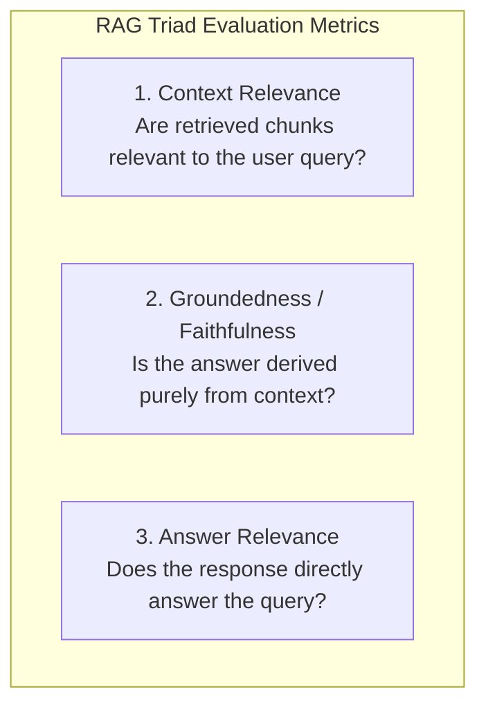

# Observability, Evaluation & Testing Suite

This document defines structured logging standards, system metrics, retrieval evaluation benchmarks (RAG Triad), and the automated testing strategy for the Knowledge Engine.

---

## 📊 Structured Logging & Correlation IDs

Every HTTP request, background job, and vector search query carries a `correlationId` (UUID v4) propagated across module boundaries and output as structured JSON.

### Standard JSON Log Format
```json
{
  "timestamp": "2026-10-10T07:30:15.123Z",
  "level": "info",
  "service": "ke-monolith",
  "module": "indexing",
  "correlationId": "c8f1d32a-5b6c-489e-9d22-10f54e129841",
  "jobId": "embed:4a1c5d9e:2",
  "documentId": "4a1c5d9e-1111-2222-3333-444455556666",
  "action": "chunk_and_embed_completed",
  "durationMs": 420,
  "chunkCount": 8,
  "tokenCount": 3210
}
```

---

## 📈 System Metrics & Health Telemetry

Exposed via `/metrics` (or lightweight `/health/status` JSON endpoint for local dev):

| Metric Name | Type | Description | Alert / Warning Threshold |
| :--- | :--- | :--- | :--- |
| `ke_ingestion_queue_depth` | Gauge | Number of waiting sync jobs in BullMQ | `> 50 jobs` |
| `ke_embedding_queue_depth` | Gauge | Number of waiting chunk/embed jobs | `> 500 jobs` |
| `ke_embedding_duration_ms` | Histogram | Time to chunk and embed a document | `p95 > 2500ms` |
| `ke_llm_inference_latency_ms` | Histogram | Time for local LLM to generate answer | `p95 > 5000ms` |
| `ke_retrieval_reciprocal_rank` | Gauge | Average RRF score for top retrieval | `< 0.015` |
| `ke_outbox_pending_count` | Gauge | Number of un-published outbox rows | `> 100 rows for > 60s` |

---

## 🎯 Retrieval & RAG Evaluation Framework

To prevent silent retrieval degradation, the RAG pipeline is evaluated against the **RAG Triad**:



### Automated Synthetic Evaluation Dataset (`tests/fixtures/rag_eval_dataset.json`)
Contains curated question-answer-citation test cases:

```json
[
  {
    "id": "eval-001",
    "question": "How do I run database migrations locally?",
    "expectedDocumentId": "doc-eng-setup-01",
    "expectedKeywords": ["typeorm migration:run", "docker compose"],
    "groundTruthAnswer": "Run `pnpm typeorm migration:run` after starting Docker Compose containers.",
    "expectedCitationUrl": "https://org.atlassian.net/wiki/spaces/ENG/pages/102938"
  },
  {
    "id": "eval-002",
    "question": "What is the timeout limit for Redis BullMQ locks?",
    "expectedDocumentId": "doc-arch-jobs-02",
    "expectedKeywords": ["30000ms", "lockDuration"],
    "groundTruthAnswer": "The lock duration for BullMQ embedding jobs is 30,000 milliseconds (30 seconds).",
    "expectedCitationUrl": "https://notion.so/org/Jobs-Architecture-9988"
  },
  {
    "id": "eval-003",
    "question": "What is the secret recipe for the cafeteria apple pie?",
    "expectedDocumentId": null,
    "expectedKeywords": [],
    "groundTruthAnswer": "I do not have sufficient information in the indexed documentation to answer this question.",
    "isUnanswerable": true
  }
]
```

### Automated Eval Runner Script (`pnpm test:eval`)
Calculates:
- **Hit Rate @ 5**: Percentage of queries where the correct document chunk appeared in Top-5. (Target: $\ge 90\%$)
- **MRR (Mean Reciprocal Rank)**: Position of first correct chunk. (Target: $\ge 0.75$)
- **Hallucination Rate on Unanswerable Queries**: Percentage of unanswerable questions correctly rejected. (Target: $100\%$)

---

## 🧪 Automated Testing Strategy

```
tests/
├── unit/
│   ├── normalizer.test.ts          # HTML/XHTML -> GFM Markdown tests
│   ├── chunker.test.ts             # Header-preserving recursive chunker tests
│   ├── citation-guard.test.ts      # [Source N] extraction & regex validation
│   └── outbox-relay.test.ts        # Idempotent batch publisher tests
├── integration/
│   ├── notion-connector.test.ts    # Mocked Notion API pagination & cursors
│   ├── confluence-connector.test.ts# Mocked Confluence v2 API parsing
│   ├── pgvector-search.test.ts     # Real pgvector HNSW search assertions
│   └── conversation-api.test.ts    # Full multi-turn chat persistence tests
└── e2e/
    └── full-slice-rag.test.ts      # Ingest -> Embed -> Search -> Answer with Citation
```

### Integration Test Example: Stateful Chat Persistence with TypeORM
```typescript
import request from 'supertest';
import { app } from '../../src/app';
import { AppDataSource } from '../../src/shared/data-source';
import { ConversationMessage } from '../../src/shared/entities/ConversationMessage.entity';

describe('Conversation API Integration', () => {
  it('should persist conversation, user message, and grounded assistant response', async () => {
    // 1. Initial user request without conversation ID
    const res1 = await request(app)
      .post('/api/v1/chat')
      .send({ message: 'How do I run database migrations?' });

    expect(res1.status).toBe(200);
    expect(res1.body.conversationId).toBeDefined();
    expect(res1.body.citations.length).toBeGreaterThan(0);
    expect(res1.body.content).toContain('[Source 1]');

    const conversationId = res1.body.conversationId;

    // 2. Follow-up request with same conversation ID
    const res2 = await request(app)
      .post('/api/v1/chat')
      .send({
        conversationId,
        message: 'Are there any flags for rolling back?'
      });

    expect(res2.status).toBe(200);
    expect(res2.body.conversationId).toBe(conversationId);

    // 3. Verify messages are persisted in PostgreSQL via TypeORM
    const msgRepo = AppDataSource.getRepository(ConversationMessage);
    const messages = await msgRepo.find({
      where: { conversationId },
      order: { createdAt: 'ASC' }
    });

    expect(messages.length).toBe(4); // 2 user + 2 assistant messages
    expect(messages[1].citations).not.toEqual([]);
  });
});
```
