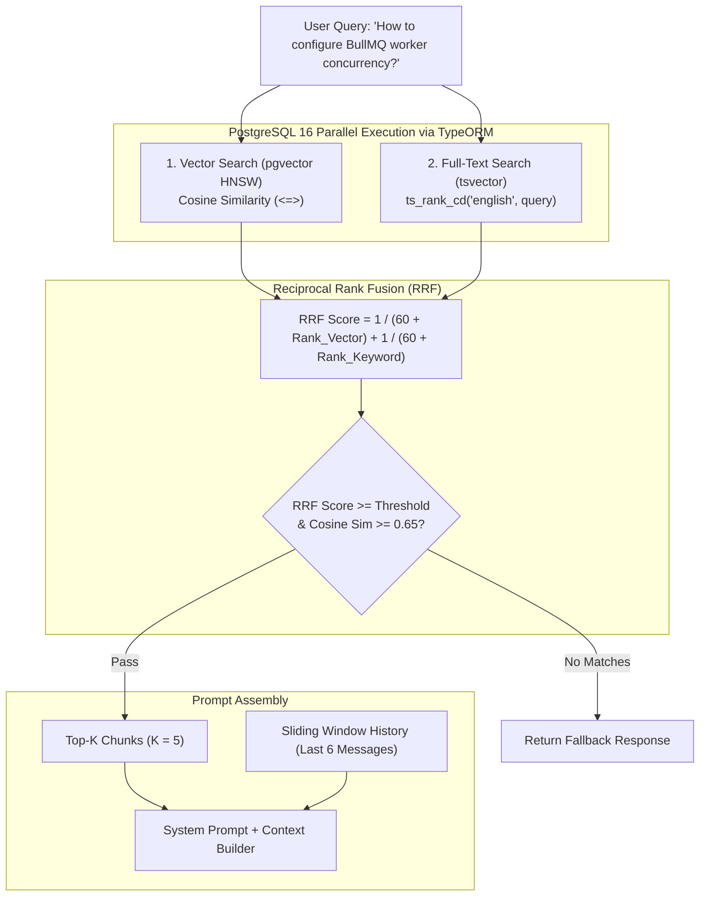

# Retrieval, Citations & Chat Engine

This document details the chunking specifications, vector search, hybrid ranking, sliding-window conversation management, citation verification, and fallback policies for the Knowledge Engine.

---

## ✂️ Markdown-Aware Semantic Chunking Strategy

Standard fixed-character chunkers destroy table structures and orphan code blocks. The chunking engine uses **structural Markdown awareness**:

```
[Normalized Document]
   │
   ├─► 1. Split on Top-Level Headers (# H1, ## H2)
   │
   ├─► 2. Sub-split Large Sections with Recursive Separators:
   │      ["\n\n", "\n", " ", ""]
   │
   └─► 3. Preserve Protected Blocks:
          - Markdown Tables (never split across rows if < max_tokens)
          - Fenced Code Blocks (never split mid-block)
```

### Chunk Parameters & Metadata
- **Target Size**: 400 - 512 tokens (~1,600 - 2,000 characters).
- **Overlap**: 64 tokens (~250 characters) to preserve boundary context.
- **Context Injection**: Each chunk prepends its hierarchical path:
  ```markdown
  [Document: Engineering Onboarding > Local Setup > Docker Configuration]
  Run `docker compose up -d` to start local PostgreSQL and Redis containers.
  ```

---

## 🔍 Hybrid Retrieval Architecture

> **As implemented** (`apps/backend/src/modules/indexing/retrieval/vector-store.service.ts`): only chunks whose document is not deleted, is `indexed`, matches the chunk's `document_version`, and whose `embedding_model` equals the active model are searched. The keyword side ORs the question's stemmed lexemes against the stored `search_vector` (an AND query rarely matches natural questions). The relevance gate (`RETRIEVAL_MIN_SIMILARITY`, default 0.65) and context selection (≤ 5 sources, ≤ 2 per document, token budget) run after fusion. The SQL below is the original sketch.

To achieve high recall across conceptual questions and keyword lookups, KE implements **Hybrid Search**:



### Hybrid Query Implementation in TypeORM
```typescript
import { DataSource } from 'typeorm';

export interface ChunkSearchResult {
  chunkId: string;
  documentId: string;
  title: string;
  sourceUrl: string;
  content: string;
  metadata: Record<string, any>;
  cosineSimilarity: number;
  rrfScore: number;
}

export async function searchHybrid(
  dataSource: DataSource,
  queryText: string,
  queryEmbedding: number[],
  topK: number = 5
): Promise<ChunkSearchResult[]> {
  const embeddingString = `[${queryEmbedding.join(',')}]`;

  const rawResults = await dataSource.query(`
    WITH vector_matches AS (
        SELECT 
            c.id,
            c.document_id,
            c.content,
            c.metadata,
            d.title,
            d.source_url,
            1 - (c.embedding <=> $1::vector) AS cosine_similarity,
            ROW_NUMBER() OVER (ORDER BY c.embedding <=> $1::vector) AS vector_rank
        FROM document_chunk c
        JOIN document d ON c.document_id = d.id
        WHERE d.deleted_at IS NULL
        ORDER BY c.embedding <=> $1::vector
        LIMIT 20
    ),
    text_matches AS (
        SELECT 
            c.id,
            c.document_id,
            c.content,
            c.metadata,
            d.title,
            d.source_url,
            ts_rank_cd(to_tsvector('english', c.content), plainto_tsquery('english', $2)) AS text_rank_score,
            ROW_NUMBER() OVER (ORDER BY ts_rank_cd(to_tsvector('english', c.content), plainto_tsquery('english', $2)) DESC) AS text_rank
        FROM document_chunk c
        JOIN document d ON c.document_id = d.id
        WHERE d.deleted_at IS NULL 
          AND to_tsvector('english', c.content) @@ plainto_tsquery('english', $2)
        LIMIT 20
    )
    SELECT 
        COALESCE(v.id, t.id) AS "chunkId",
        COALESCE(v.document_id, t.document_id) AS "documentId",
        COALESCE(v.title, t.title) AS "title",
        COALESCE(v.source_url, t.source_url) AS "sourceUrl",
        COALESCE(v.content, t.content) AS "content",
        COALESCE(v.metadata, t.metadata) AS "metadata",
        COALESCE(v.cosine_similarity, 0.0) AS "cosineSimilarity",
        (COALESCE(1.0 / (60 + v.vector_rank), 0.0) + COALESCE(1.0 / (60 + t.text_rank), 0.0)) AS "rrfScore"
    FROM vector_matches v
    FULL OUTER JOIN text_matches t ON v.id = t.id
    ORDER BY "rrfScore" DESC
    LIMIT $3;
  `, [embeddingString, queryText, topK]);

  return rawResults;
}
```

---

## 💬 Stateful Conversation & Context Management

### 1. Multi-Turn Sliding Context Window
Local 7B models have finite effective context (4k - 8k tokens). To maintain quality:
- Fetch only the **last 6 messages** (3 user-assistant turns) for the active `conversation_id`.
- Do **not** rely on LLM memory to recall knowledge. Every user turn executes a fresh retrieval query against the PostgreSQL vector store.

```typescript
import { DataSource } from 'typeorm';
import { ConversationMessage } from '../../shared/entities/ConversationMessage.entity';

export async function getRecentConversationHistory(
  dataSource: DataSource,
  conversationId: string
): Promise<Array<{ role: 'user' | 'assistant'; content: string }>> {
  const msgRepo = dataSource.getRepository(ConversationMessage);

  const messages = await msgRepo.find({
    where: { conversationId, status: 'completed' },
    order: { createdAt: 'DESC' },
    take: 6
  });

  return messages.reverse().map(m => ({
    role: m.role as 'user' | 'assistant',
    content: m.content
  }));
}
```

### 2. Conversation API Contracts

The wire contract lives in `packages/api-client/src/modules/chat.ts`; the backend implements it in `apps/backend/src/modules/conversation/`.

| Endpoint | Response |
| :--- | :--- |
| `GET /api/v1/chat` | Conversations, newest activity first: `id`, `title`, `lastMessagePreview`, `messageCount`, `updatedAt` |
| `GET /api/v1/chat/:id` | Full history; assistant messages carry `outcome`, `refusalReason`, `sources[]` (all context sources, each with `cited`), `run` (trace id, models, tokens, stage timings) and `status: "stopped"` when interrupted |
| `DELETE /api/v1/chat/:id` | `204` |
| `POST /api/v1/chat` / `POST /api/v1/chat/:id` | `{ "message": string }` (1–2000 chars) → **server-sent event stream** |

Answers stream as SSE (`text/event-stream`, one JSON object per `data:` line), in this order:

```
meta     { conversationId, userMessageId, assistantMessageId, traceId, conversationTitle }
stage*   { stage: rewrite|embed|retrieve|select|generate|verify, status: started|completed, durationMs? }
sources  { sources: ChatSource[] }            -- omitted when refusing for lack of evidence
token*   { delta }
done     { outcome, refusalReason?, content, citedIndexes, run }   -- or --
error    { code, message, retryable }         -- e.g. LLM_UNAVAILABLE
```

`done.content` is the stored text and replaces the streamed tokens (for example when an unverifiable draft becomes a refusal). Validation errors (400), unknown conversations (404) and rate limiting (429, 20 questions/min per client) are returned as plain HTTP errors before any stream opens. Closing the request cancels generation and stores the partial answer as `stopped`.

Follow-up questions are rewritten into a standalone search query (`rewrite` stage, falls back to the original after `LLM_REWRITE_TIMEOUT_MS`); the answer prompt always uses the user's original wording.

---

## 📝 Prompt Construction & Citation Enforcement

### System Prompt Template
```
You are the Knowledge Assistant, an internal technical helper.
Answer the user's question STRICTLY based on the provided Source Documents below.

RULES:
1. Every claim, instruction, or code reference MUST be cited using [Source N] notation.
2. Do NOT extrapolate, speculate, or invent facts not present in the Sources.
3. If the provided sources do not contain enough information to answer the question completely, you MUST reply:
   "I do not have sufficient information in the indexed documentation to answer this question."
4. Do NOT cite sources that do not directly support your statement.

SOURCE DOCUMENTS:
---
[Source 1: Local Environment Setup (https://notion.so/org/Local-Setup-12345)]
The Docker compose configuration files are located in the repository root under `docker-compose.yaml`.

[Source 2: Database Migrations (https://org.atlassian.net/wiki/spaces/ENG/pages/4455)]
Run migrations using `pnpm typeorm migration:run` before starting the application.
---
```

---

## 🛡️ Citation Integrity Verification & Fallback Rules

```mermaid
flowchart TD
    RawLLM["Raw LLM Text Response"] --> ExtractRegex["Extract Citations: regex /\[Source (\d+)\]/g"]
    ExtractRegex --> Validate{"Are all cited Source N\nin retrieved chunks list?"}
    Validate -->|No (Hallucinated Source ID)| StripOrFallback["Strip invalid citation or trigger fallback"]
    Validate -->|Yes| CheckScore{"Did top retrieval\nexceed similarity threshold (0.65)?"}
    CheckScore -->|No| FallbackResponse["Return: 'I do not have sufficient information in the indexed documentation to answer this question.'"]
    CheckScore -->|Yes| AttachCitations["Build structured citations JSON & commit to DB"]
```

### Insufficient Evidence Trigger Conditions
1. **Empty Search Result**: No chunks returned above similarity threshold `0.65`.
2. **Explicit LLM Refusal**: LLM completion contains phrase matching *"insufficient information"* or *"not mentioned in the context"*.
3. **Database Write Precondition**: The response is **never** sent to the client unless the database commit to `conversation_message` succeeds.
