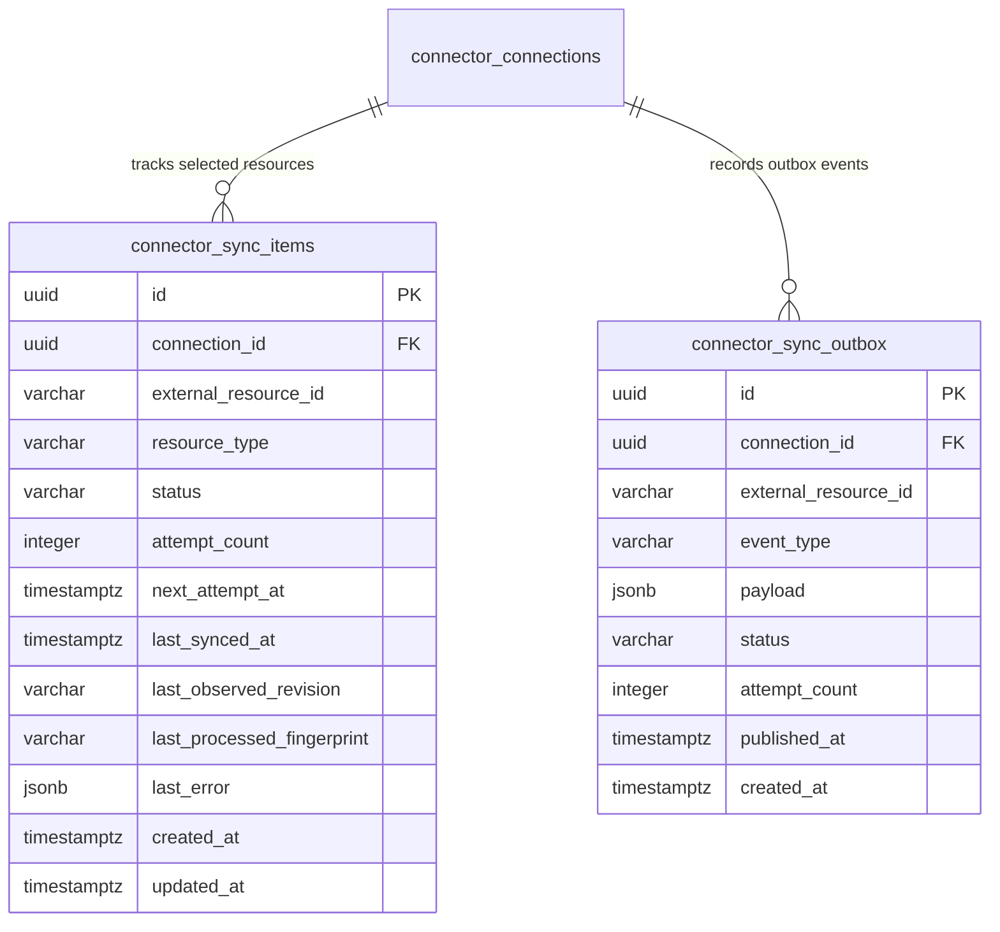
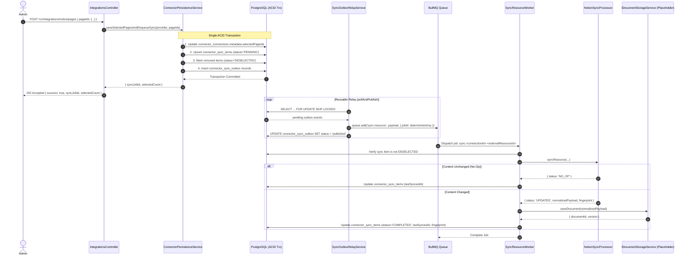

# Technical Design: Durable Connector Sync, Source Change Detection, and Version-Safe Updates

## Context

The Knowledge Engine enables knowledge ingestion from external tools like Notion and Confluence. In prior phases:
- `notion-oauth-integration` implemented OAuth2 handshake and anti-CSRF state tokens.
- `notion-connector-canonical-normalization` created `NotionAdapter`, `NotionParser`, and `CanonicalDocumentNormalizer` converting raw Notion block trees into canonical Markdown AST with SHA-256 hashes.
- `durable-connector-persistence` introduced PostgreSQL storage for connections (`connector_connections`) and encrypted credentials (`connector_credentials`).

Currently, `POST /v1/integrations/notion/pages` simply writes `selectedPageIds` to JSONB `connector_connections.metadata.selectedPageIds`. There is no background worker, no change detection, and no tracking of per-resource synchronization state.

This scoped design introduces:
1. Durable per-resource tracking (`connector_sync_items`).
2. A transactional outbox (`connector_sync_outbox`) and reusable interface-based poller relay to reliably dispatch jobs to BullMQ.
3. An asynchronous `POST /v1/integrations/notion/pages` returning `202 Accepted`.
4. Provider-neutral change detection (`KnowledgeSyncProcessor`).
5. A background worker (`SyncResourceWorker`) orchestrating retrieval, parsing, and normalization, followed by persistence through a placeholder document storage service (`IDocumentStorageService`).

See [proposal.md](file:///Users/gauravbhandari/Developer/learning/frogtoberfest-knowledge-engine/openspec/changes/durable-connector-sync/proposal.md) for motivation and [specs/connector-sync/spec.md](file:///Users/gauravbhandari/Developer/learning/frogtoberfest-knowledge-engine/openspec/changes/durable-connector-sync/specs/connector-sync/spec.md) for normative requirements.

---

## Goals / Non-Goals

### Goals
- **Durability Across Restarts**: Selected resources remain continuously tracked in `connector_sync_items`.
- **Transactional Outbox Pattern**: Eliminate dual-write race conditions between PostgreSQL transactions and BullMQ publishing via `connector_sync_outbox` and a poller relay with `SELECT ... FOR UPDATE SKIP LOCKED`.
- **Reusable Poller Interface**: Abstract the outbox relay behind an interface (`ISyncOutboxRelay` / `ISyncPoller`) so it easily reconciles with incoming main-branch poller implementations.
- **Asynchronous Selection Endpoint**: `POST /v1/integrations/notion/pages` validates selection, updates sync tracking items and outbox in an ACID transaction, and returns `202 Accepted` immediately.
- **Provider-Neutral Change Detection**: Decouple provider adapters from queue workers. Use provider revision metadata (`last_edited_time`) and SHA-256 content fingerprints to prevent redundant document versions when content is unchanged.
- **Placeholder Document Storage Integration**: Define a clean `IDocumentStorageService` contract that the worker calls with the normalized document payload upon successful parsing.
- **Optimistic Concurrency & Stale Result Protection**: Detect race conditions between concurrent sync triggers or out-of-order workers. Discard stale results without overwriting newer state.
- **Resilient Error Classification**: Utilize `ErrorClassifier` to retry transient failures via BullMQ backoff and transition connection status to `REAUTH_REQUIRED` upon confirmed token revocation.

### Non-Goals
- **No Concrete Document / Version Entities**: Defer `documents` and `document_versions` tables to downstream indexing changes; use an injectable `IDocumentStorageService` placeholder in this phase.
- **No BullMQ Configuration from Scratch**: BullMQ connection and Redis module configuration are managed in parallel by other team members; this change only injects and utilizes the queue.
- **No Hand-Written Migrations**: The developer will generate migrations via TypeORM CLI from the entity definitions.
- **No Live External API Calls**: The worker and adapter pipeline will be tested and exercised via mocked/stubbed provider responses without requiring live Notion API credentials.

---

## Architecture & Entity Design

### 1. Database Schema & Entities



#### Entity 1: `ConnectorSyncItemEntity` (`connector_sync_items`)
Tracks ongoing synchronization state per selected resource:
- `id`: `uuid` PK
- `connectionId`: `uuid` FK -> `connector_connections(id)` ON DELETE CASCADE
- `externalResourceId`: `varchar(255)` (e.g. Notion page UUID)
- `resourceType`: `varchar(50)` (e.g. `'page'`, `'database'`)
- `status`: `varchar(30)` (`'PENDING'`, `'SYNCING'`, `'COMPLETED'`, `'FAILED'`, `'DESELECTED'`)
- `attemptCount`: `integer` default 0
- `nextAttemptAt`: `timestamptz` nullable
- `lastSyncedAt`: `timestamptz` nullable
- `lastObservedRevision`: `varchar(255)` nullable (Notion ISO `last_edited_time`)
- `lastProcessedFingerprint`: `varchar(64)` nullable (SHA-256 of canonical normalized Markdown)
- `lastError`: `jsonb` nullable
- `createdAt` / `updatedAt`: `timestamptz`

**Indexes & Constraints**:
- `UNIQUE INDEX idx_sync_item_connection_resource ON connector_sync_items (connection_id, external_resource_id)`
- `INDEX idx_sync_item_status_next_attempt ON connector_sync_items (status, next_attempt_at)`

#### Entity 2: `ConnectorSyncOutboxEntity` (`connector_sync_outbox`)
Guarantees transaction-to-queue durability:
- `id`: `uuid` PK
- `connectionId`: `uuid` FK -> `connector_connections(id)`
- `externalResourceId`: `varchar(255)`
- `eventType`: `varchar(50)` (e.g. `'SYNC_RESOURCE'`)
- `payload`: `jsonb`
- `status`: `varchar(20)` (`'pending'`, `'published'`, `'failed'`)
- `attemptCount`: `integer` default 0
- `publishedAt`: `timestamptz` nullable
- `createdAt`: `timestamptz`

**Indexes**:
- `INDEX idx_sync_outbox_pending ON connector_sync_outbox (status, created_at) WHERE status = 'pending'`

---

## Service Contracts & Interfaces

### 1. Reusable Outbox Relay / Poller Interface
```typescript
export interface ISyncOutboxRelay {
  pollAndPublish(batchSize?: number): Promise<number>;
}
```
`SyncOutboxRelayService` implements `ISyncOutboxRelay`, locking pending records with `SELECT ... FOR UPDATE SKIP LOCKED` and publishing to the BullMQ ingestion queue with deterministic IDs (`sync:<connectionId>:<externalResourceId>`).

### 2. Placeholder Document Storage Interface
```typescript
export interface IDocumentStorageService {
  saveDocument(payload: NormalizedDocumentPayload, expectedVersion?: number): Promise<{
    documentId: string;
    version: number;
    isNewVersion: boolean;
  }>;
}
```
A mock/placeholder service `DocumentStoragePlaceholderService` implements this contract in memory or logs the update, allowing downstream indexing teams to swap in the concrete database implementation without changing worker code.

### 3. Provider-Neutral Sync Processor Contract
```typescript
export interface KnowledgeSyncProcessor {
  syncResource(params: {
    connectionId: string;
    externalResourceId: string;
    lastObservedRevision?: string;
    lastProcessedFingerprint?: string;
  }): Promise<{
    status: 'NO_OP' | 'UPDATED' | 'FAILED';
    revision?: string;
    fingerprint?: string;
    normalizedPayload?: NormalizedDocumentPayload;
  }>;
}
```

---

## Queue Topology & BullMQ Lifecycle

### 1. Ingestion Queue Specifications
- **Queue Name**: `ingestion-sync-queue`
- **Job Name**: `sync-resource`
- **Job ID Format**: `sync:<connectionId>:<externalResourceId>`
- **Job Payload**:
  ```typescript
  export interface SyncResourceJobPayload {
    syncItemId: string;
    connectionId: string;
    provider: 'notion' | 'confluence';
    externalResourceId: string;
    resourceType: string;
    traceparent?: string;
    tracestate?: string;
  }
  ```

### 2. End-to-End Processing Workflow



---

## Risks / Trade-offs & Mitigations

| Risk | Impact | Mitigation |
|---|---|---|
| **Outbox Relay & Main Branch Merge Conflicts** | Duplicate poller logic | Poller logic is abstracted via `ISyncOutboxRelay` interface, making replacement straightforward when pulled from main. |
| **Worker Process Crash Mid-Sync** | Incomplete sync item state | In-flight jobs remain uncommitted until parsing completes and `IDocumentStorageService` succeeds; BullMQ lock renewal protects active jobs. |
| **Resource Deselection Mid-Job** | Stale update committed | Worker checks `connector_sync_items.status` prior to invoking `IDocumentStorageService`. If status is `DESELECTED`, work is safely aborted. |
| **Confirmed Token Revocation (401)** | Endless worker retries | `ErrorClassifier.classify(error)` identifies permanent auth failures; connection is transitioned to `REAUTH_REQUIRED` and sync item marked `FAILED`. |
