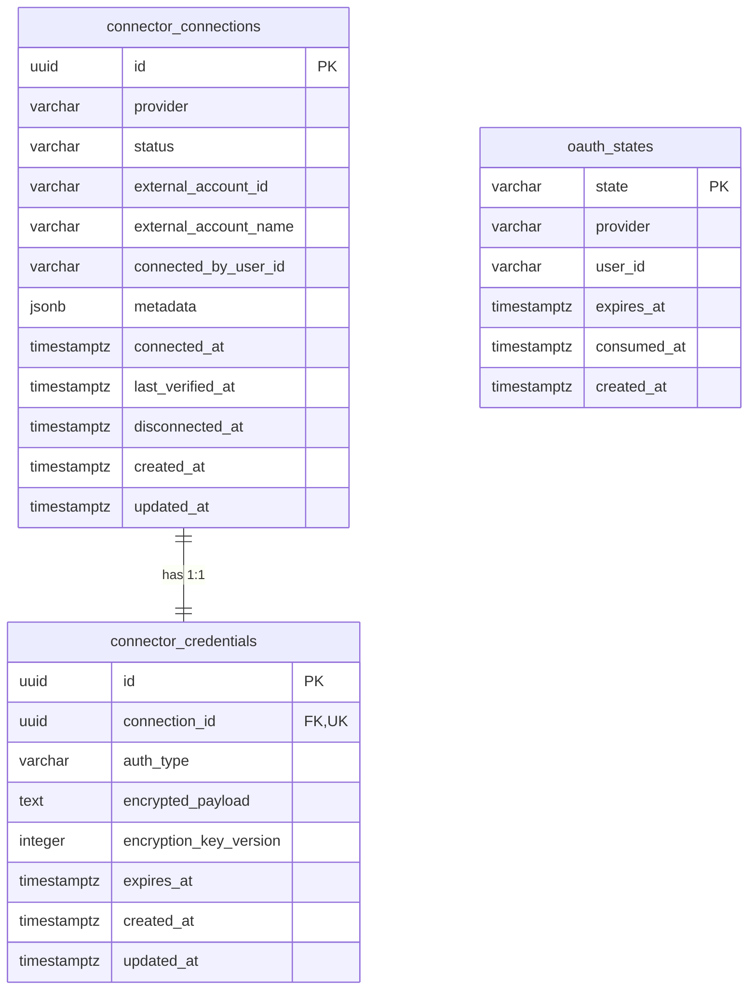
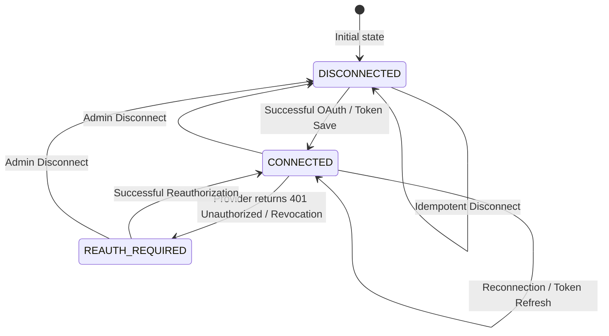

# Design Document: Durable Connector Connection Persistence

## Context

The Knowledge Engine currently handles Notion OAuth and credential handling entirely in volatile process memory via `ConnectionStorageService` (`private connection: NotionConnectionRecord | null`) and `NotionOAuthService` (`private readonly states = new Map<string, OAuthStateEntry>()`). When the NestJS application or Docker container restarts, all active connections and pending anti-CSRF state tokens are discarded.

Furthermore, `NotionClient` currently retrieves credentials from a static configuration property (`apiKey` in `AppConfigService`), while `NotionPagesService` expects an access token passed into its methods.

This design introduces a durable PostgreSQL 16 persistence layer with TypeORM entities, atomic transactions, authenticated AES-256-GCM credential encryption, partial unique indexing for active connection exclusivity, and durable OAuth anti-CSRF state tokens.

See [proposal.md](file:///Users/gauravbhandari/Developer/learning/frogtoberfest-knowledge-engine/openspec/changes/durable-connector-persistence/proposal.md) for motivation and [specs/connector-persistence/spec.md](file:///Users/gauravbhandari/Developer/learning/frogtoberfest-knowledge-engine/openspec/changes/durable-connector-persistence/specs/connector-persistence/spec.md) for normative requirements.

---

## Goals / Non-Goals

### Goals
- **Durability**: Integration connections, credentials, and in-flight OAuth anti-CSRF states survive container restarts, crashes, and redeployments.
- **Single Source of Truth**: PostgreSQL 16 stores connector metadata and credentials with strict transactional consistency.
- **Active Connection Exclusivity**: Enforce at most one active connection (`CONNECTED` or `REAUTH_REQUIRED`) per provider at the database level using a PostgreSQL partial unique index.
- **Zero Credential Leakage**: Decrypted credentials exist in memory only during active provider HTTP calls. Credentials are never returned in status DTOs, never logged, and never included in exception messages.
- **Provider Extensibility**: A unified `connector_connections` and `connector_credentials` schema capable of supporting Confluence and future providers without adding provider-specific credential tables.
- **Graceful Failure Resilience**: Transient network failures do not downgrade or drop credentials; confirmed authorization revocations transition connection status to `REAUTH_REQUIRED`.

### Non-Goals
- **Multi-Tenancy / Organizations**: No multi-tenant workspace tables, organization IDs, or per-user connection accounts. The system is strictly single-tenant.
- **Bring-Your-Own OAuth App (BYO OAuth)**: Server-side application credentials (`NOTION_CLIENT_ID`, `NOTION_CLIENT_SECRET`) remain managed exclusively via server environment configuration.
- **Ingestion Cleanup on Disconnect**: Disconnecting a connector disables future synchronizations and invalidates credentials, but does not wipe ingested documents or vector chunks from the database.
- **Generic Connector Framework Over-Engineering**: Keep the design minimal and focused on PostgreSQL persistence, encryption, and lifecycle management without introducing complex plugin registries or dynamic driver loaders.

---

## Architecture & Entity Design

### 1. Database Schema & Entities



#### Entity 1: `ConnectorConnectionEntity` (`connector_connections`)
Represents the durable integration connection record.

| Column | Type | Nullable | Description |
|---|---|---|---|
| `id` | `uuid` | No | Primary Key (`gen_random_uuid()`) |
| `provider` | `varchar(50)` | No | Integration provider identifier (e.g. `'notion'`, `'confluence'`) |
| `status` | `varchar(30)` | No | Enum: `'CONNECTED'`, `'REAUTH_REQUIRED'`, `'DISCONNECTED'` |
| `externalAccountId` | `varchar(255)` | No | Provider workspace or account identifier (e.g. Notion workspace ID) |
| `externalAccountName` | `varchar(255)` | Yes | Human-readable workspace name |
| `connectedByUserId` | `varchar(100)` | No | Initiating admin identifier (defaults to `'admin-user'`) |
| `metadata` | `jsonb` | Yes | Non-sensitive provider metadata (e.g. `workspaceIcon`, `selectedPageIds`, bot ID) |
| `connectedAt` | `timestamptz` | No | Timestamp when connection was successfully authorized |
| `lastVerifiedAt` | `timestamptz` | Yes | Timestamp of last successful API call or token verification |
| `disconnectedAt` | `timestamptz` | Yes | Timestamp when connection was disconnected |
| `createdAt` | `timestamptz` | No | Record creation timestamp |
| `updatedAt` | `timestamptz` | No | Record update timestamp |

**Indexes & Constraints**:
- **Partial Unique Index**:
  ```sql
  CREATE UNIQUE INDEX idx_connector_connection_provider_active 
  ON connector_connections (provider) 
  WHERE status IN ('CONNECTED', 'REAUTH_REQUIRED');
  ```
  *Guarantees at most one active connection per provider at the database level.*
- Standard index on `(provider, status)`.

#### Entity 2: `ConnectorCredentialEntity` (`connector_credentials`)
Stores encrypted authentication material in a strict 1-to-1 relationship with `ConnectorConnectionEntity`.

| Column | Type | Nullable | Description |
|---|---|---|---|
| `id` | `uuid` | No | Primary Key (`gen_random_uuid()`) |
| `connectionId` | `uuid` | No | Foreign Key -> `connector_connections(id)` with `ON DELETE CASCADE`, Unique |
| `authType` | `varchar(30)` | No | Enum: `'OAUTH2'`, `'API_TOKEN'` |
| `encryptedPayload` | `text` | No | AES-256-GCM encrypted payload (`iv.tag.ciphertext` format) |
| `encryptionKeyVersion` | `integer` | No | Key version used for encryption (initially `1`) |
| `expiresAt` | `timestamptz` | Yes | Nullable token expiration timestamp |
| `createdAt` | `timestamptz` | No | Record creation timestamp |
| `updatedAt` | `timestamptz` | No | Record update timestamp |

**Indexes & Constraints**:
- `UNIQUE (connection_id)`: Enforces 1-to-1 relationship.
- Foreign Key: `connection_id` references `connector_connections(id)` on delete cascade.

#### Entity 3: `OAuthStateEntity` (`oauth_states`)
Stores anti-CSRF state tokens generated during OAuth authorization initiation.

| Column | Type | Nullable | Description |
|---|---|---|---|
| `state` | `varchar(64)` | No | Primary Key: 32-byte cryptographically secure hex string |
| `provider` | `varchar(50)` | No | Integration provider (e.g. `'notion'`) |
| `userId` | `varchar(100)` | No | Admin user initiating the flow |
| `expiresAt` | `timestamptz` | No | Expiration timestamp (created_at + 10 minutes) |
| `consumedAt` | `timestamptz` | Yes | Nullable timestamp when token was validated & consumed |
| `createdAt` | `timestamptz` | No | Record creation timestamp |

**Indexes & Constraints**:
- Primary Key on `state`.
- Index on `expiresAt` for periodic expiration cleanup.

---

## Technical Decisions & Component Architecture

### Decision 1: Application-Level AES-256-GCM Encryption via Dedicated Service

**Choice**: Extract encryption logic from `ConnectionStorageService` into a standalone, testable `CredentialEncryptionService`.

```
Plaintext Credential Payload (JSON)
  │
  ▼ [crypto.randomBytes(12) IV] + [AES-256-GCM cipher with 32B Derived Key]
  │
  ▼
Encrypted Payload: "<iv_hex>.<tag_hex>.<ciphertext_hex>"
Stored with: `encryptionKeyVersion: 1`
```

- **Algorithm**: AES-256-GCM with authenticated tags prevents both ciphertext disclosure and undetected tampering.
- **Payload Structure**: Plaintext JSON stringified object:
  ```json
  {
    "accessToken": "secret_notion_access_token",
    "tokenType": "bearer",
    "botId": "..."
  }
  ```
  Supporting any provider without adding provider-specific columns.
- **Key Derivation**: SHA-256 digest of `configService.encryptionSecret`.
- **Key Versioning**: `encryptionKeyVersion` column allows future zero-downtime key rotation by reading the version to determine which decryption key to use.
- **Safe Failure**: If decryption fails (corrupted ciphertext, invalid auth tag, or invalid key), throws an explicit internal error and logs `LogEvents.INTEGRATION_DECRYPTION_FAILED` without printing the key, payload, or token.

*Alternatives Considered*:
- *Postgres `pgcrypto`*: Rejected because it pushes cryptographic key management into database queries and database backups, increasing blast radius if database dumps are compromised.
- *Raw token string encryption*: Rejected in favor of JSON payload encryption to accommodate refresh tokens, token expiration, or extra provider tokens without schema alterations.

---

### Decision 2: Atomic Transactional Boundaries for Persistence

**Choice**: Persist connection metadata and encrypted credentials atomically using TypeORM `EntityManager.transaction` or `QueryRunner`.

```typescript
/* Pseudocode representation */
await this.dataSource.transaction(async (manager) => {
  /* 1. If an existing active connection exists for provider, update or mark as replaced */
  /* 2. Insert or update ConnectorConnectionEntity */
  /* 3. Insert or update ConnectorCredentialEntity */
});
```

- **Reconnection Behavior**:
  - When reauthorizing an existing provider, we first perform the external OAuth exchange.
  - If token exchange fails, the transaction is never opened and the existing valid connection remains completely intact.
  - If token exchange succeeds, the transaction atomically updates the connection metadata and replaces the credential payload.
- **Disconnect Behavior**:
  - Setting `status = 'DISCONNECTED'`, recording `disconnectedAt = new Date()`, and clearing the `encryptedPayload` (or deleting the credential row) is done idempotently. If already disconnected, returns cleanly without error.

---

### Decision 3: Single Active Connection Enforcement

**Choice**: Use a PostgreSQL partial unique index:
```sql
CREATE UNIQUE INDEX idx_connector_connection_provider_active 
ON connector_connections (provider) 
WHERE status IN ('CONNECTED', 'REAUTH_REQUIRED');
```

- **Why**: An application-level check (`SELECT ... WHERE status = 'CONNECTED'`) is vulnerable to race conditions under concurrent OAuth callback requests or rapid user clicks. The partial unique index enforces exclusivity at the database engine level.
- **Multi-Provider Support**: Allows one active Notion connection, one active Confluence connection, etc.
- **Historical Disconnected Records**: Disconnected records (`status = 'DISCONNECTED'`) are excluded by the `WHERE` clause, permitting audit trails of past disconnections.

*Alternatives Considered*:
- *Standard UNIQUE on `(provider)`*: Rejected because it would require either deleting past records upon disconnect or overwriting the single row, preventing connection history and auditability.

---

### Decision 4: Durable Anti-CSRF State Storage

**Choice**: Store OAuth state tokens in a dedicated PostgreSQL table `oauth_states`.

- **State Verification & Consumption**:
  ```sql
  UPDATE oauth_states 
  SET consumed_at = NOW() 
  WHERE state = $1 
    AND provider = $2 
    AND consumed_at IS NULL 
    AND expires_at > NOW()
  RETURNING state, user_id;
  ```
  - Executed atomically in a single statement.
  - Returns rows only if the state exists, has not expired, and has not already been consumed.
  - If zero rows return, immediately reject the callback as an invalid, expired, or replayed state.
- **TTL**: 10 minutes.
- **Restart Resilience**: Because state is persisted in PostgreSQL, restarting the NestJS service while an administrator is authenticating in Notion's popup does not break the callback.

*Alternatives Considered*:
- *Encrypted / signed state cookie or JWT*: Rejected because stateless cookies do not provide immediate server-side single-use revocation without a server-side revocation list.

---

### Decision 5: Dynamic Credential Resolution in `NotionClient` & `NotionPagesService`

**Choice**: Update `NotionClient` to dynamically resolve access credentials through `ConnectorPersistenceService` per request.

```typescript
/* Inside NotionClient */
private async getAccessToken(): Promise<string> {
  const token = await this.persistenceService.getDecryptedToken('notion');
  if (!token) {
    throw new UnauthorizedException('Notion connector is not connected or credentials missing');
  }
  return token;
}
```

- **Strict Isolation**: Eliminates static `NOTION_API_KEY` fallback for runtime connector requests.
- **Provider Status Check**: If connection status is `DISCONNECTED` or `REAUTH_REQUIRED`, request halts immediately before making external network calls.
- **Status Downgrade on 401**: If `NotionClient` receives an HTTP 401 Unauthorized from Notion during an API request, it reports the invalidation to `ConnectorPersistenceService.markReauthRequired('notion')`.

---

## Lifecycle States & State Transition Matrix



| Current State | Event | New State | Credential Handling |
|---|---|---|---|
| `DISCONNECTED` | Successful OAuth Authorization | `CONNECTED` | Encrypted payload saved atomically |
| `CONNECTED` | Transient Network Timeout / 500 | `CONNECTED` | Credentials preserved; retry executed |
| `CONNECTED` | Confirmed 401 Unauthorized / Token Revocation | `REAUTH_REQUIRED` | Credentials preserved for inspection/audit; marked unverified |
| `REAUTH_REQUIRED`| Successful OAuth Reauthorization | `CONNECTED` | Credentials overwritten atomically with new encrypted token |
| `REAUTH_REQUIRED`| Failed Reauthorization Attempt | `REAUTH_REQUIRED`| Existing credentials unmodified |
| `CONNECTED` | Admin Disconnect | `DISCONNECTED` | Credentials wiped or scrambled; `disconnectedAt` set |
| `DISCONNECTED` | Admin Disconnect | `DISCONNECTED` | No-op (idempotent success) |

---

## Scenarios Handling (Detailed Walkthrough)

### Scenario A: Normal Restart
1. Admin connects Notion. Credentials saved in PostgreSQL (`connector_connections` and `connector_credentials`).
2. Backend process restarts or container redeploys.
3. On first Notion API call or status check, `ConnectorPersistenceService` queries PostgreSQL.
4. Record found with status `CONNECTED`. Credential payload is decrypted in-memory.
5. Notion request succeeds without requiring user re-authentication.

### Scenario B: Failed Reconnect
1. Admin starts a reconnect flow while Notion is already connected.
2. User cancels in Notion or network fails during code exchange.
3. Error is caught before any database mutation occurs.
4. Existing connection in PostgreSQL remains intact and active.

### Scenario C: Provider Temporarily Unavailable
1. Notion API returns 502 Bad Gateway, 503 Service Unavailable, or TCP connection timeout.
2. `RetryPolicy` and `CircuitBreaker` in `NotionClient` handle retry.
3. Connection status in PostgreSQL is **not** altered. It remains `CONNECTED`.

### Scenario D: Confirmed Credential Invalidation
1. Notion API returns 401 Unauthorized (`invalid_token` / `restricted_resource`).
2. Client intercepts 401 and calls `ConnectorPersistenceService.updateStatus('notion', 'REAUTH_REQUIRED')`.
3. Subsequent status check alerts administrator that reauthorization is required.

### Scenario E: Encryption Key Unavailable or Changed
1. `ENCRYPTION_SECRET` is missing or mismatched after configuration change.
2. Decryption fails authentication tag validation (`decipher.final()` throws).
3. `CredentialEncryptionService` catches error and throws a safe `InternalServerErrorException('Failed to decrypt connector credentials')`.
4. Operational logs record `LogEvents.INTEGRATION_DECRYPTION_FAILED` without exposing keys or payloads.
5. Stored credentials in PostgreSQL remain untouched (not deleted or corrupted).

### Scenario F: Concurrent Callbacks
1. Admin rapidly double-clicks or two identical callbacks hit `/oauth/callback` simultaneously.
2. Both attempt to validate anti-CSRF state in `oauth_states`.
3. Due to `WHERE consumed_at IS NULL` atomic update, exactly one callback succeeds; the second receives 0 updated rows and is rejected immediately.
4. Even if both reached the connection save, the partial unique index `idx_connector_connection_provider_active` prevents two active rows.

---

## Migration Plan & Database Dependencies

### 1. Dependencies
Add to `apps/backend/package.json`:
- `typeorm`: `^0.3.20`
- `@nestjs/typeorm`: `^10.0.2`
- `pg`: `^8.13.1`
- `@types/pg`: `^8.11.10` (devDependencies)

### 2. TypeORM Configuration in NestJS
Configure `TypeOrmModule.forRootAsync` in `AppModule`:
- Load database connection parameters from `AppConfigService` (`DATABASE_URL` or individual `POSTGRES_*` variables).
- Set `synchronize: false` in production and test environments (always use migrations).
- Register entities: `ConnectorConnectionEntity`, `ConnectorCredentialEntity`, `OAuthStateEntity`.

### 3. Migration: `CreateConnectorPersistenceTables`
Migration script in global migrations folder (`apps/backend/src/database/migrations/1700000000000-create-connector-persistence-tables.ts`):
```sql
CREATE EXTENSION IF NOT EXISTS "uuid-ossp";

CREATE TABLE connector_connections (
    id UUID PRIMARY KEY DEFAULT gen_random_uuid(),
    provider VARCHAR(50) NOT NULL,
    status VARCHAR(30) NOT NULL DEFAULT 'CONNECTED',
    external_account_id VARCHAR(255) NOT NULL,
    external_account_name VARCHAR(255),
    connected_by_user_id VARCHAR(100) NOT NULL DEFAULT 'admin-user',
    metadata JSONB,
    connected_at TIMESTAMPTZ NOT NULL DEFAULT NOW(),
    last_verified_at TIMESTAMPTZ,
    disconnected_at TIMESTAMPTZ,
    created_at TIMESTAMPTZ NOT NULL DEFAULT NOW(),
    updated_at TIMESTAMPTZ NOT NULL DEFAULT NOW()
);

CREATE UNIQUE INDEX idx_connector_connection_provider_active 
ON connector_connections (provider) 
WHERE status IN ('CONNECTED', 'REAUTH_REQUIRED');

CREATE TABLE connector_credentials (
    id UUID PRIMARY KEY DEFAULT gen_random_uuid(),
    connection_id UUID NOT NULL UNIQUE REFERENCES connector_connections(id) ON DELETE CASCADE,
    auth_type VARCHAR(30) NOT NULL DEFAULT 'OAUTH2',
    encrypted_payload TEXT NOT NULL,
    encryption_key_version INTEGER NOT NULL DEFAULT 1,
    expires_at TIMESTAMPTZ,
    created_at TIMESTAMPTZ NOT NULL DEFAULT NOW(),
    updated_at TIMESTAMPTZ NOT NULL DEFAULT NOW()
);

CREATE TABLE oauth_states (
    state VARCHAR(64) PRIMARY KEY,
    provider VARCHAR(50) NOT NULL,
    user_id VARCHAR(100) NOT NULL,
    expires_at TIMESTAMPTZ NOT NULL,
    consumed_at TIMESTAMPTZ,
    created_at TIMESTAMPTZ NOT NULL DEFAULT NOW()
);

CREATE INDEX idx_oauth_states_expires_at ON oauth_states(expires_at);
```

---

## Risks / Trade-offs

| Risk | Impact | Mitigation |
|---|---|---|
| **Encryption key loss / desynchronization** | If `ENCRYPTION_SECRET` is changed or lost, stored credentials cannot be decrypted. | Document operational requirements: back up the key alongside database backups. When key is missing/corrupted, fail safely with an operational error without wiping the database record. |
| **TypeORM and pg installation in pnpm monorepo** | Potential dependency conflicts or build issues with NestJS 12. | Use clean peer dependencies matching NestJS 12 / Node 24 specifications. Verify `pnpm check-types` and Jest mocks before committing. |
| **Existing tests relying on in-memory storage** | Existing integration tests might fail if they require a live PostgreSQL instance. | Provide a mock/repository abstraction or in-memory SQLite/Postgres test harness for unit tests so `pnpm test` continues to run fast and isolated in CI without requiring a running Docker container. |
| **Race conditions on reconnect** | Reconnection might try to insert a new connection while an old one is still `CONNECTED`. | Use an atomic transaction that marks previous active rows as replaced or updates the existing connection and credential row in place. |
